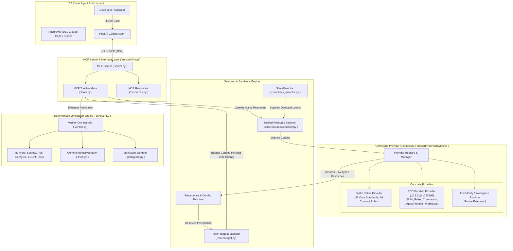
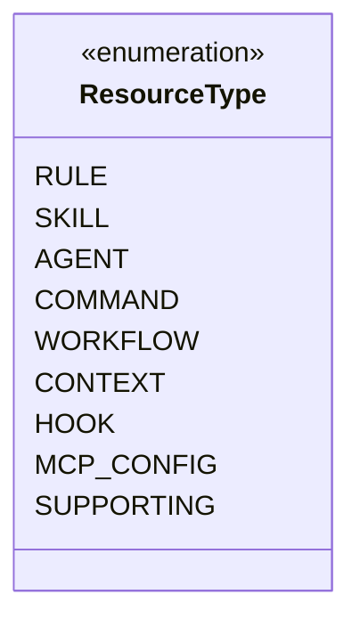
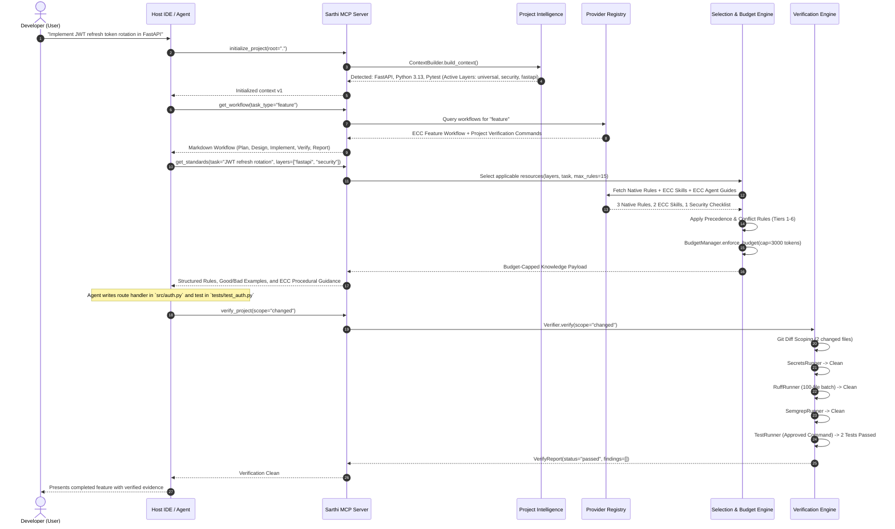

# ECC Integration Architecture Design

> **Document:** `docs/architecture/ECC_INTEGRATION_DESIGN.md`  
> **Status:** Approved Architectural Specification (Reconciled)  
> **Target Project:** Sarthi (evolving from Sarthi)  
> **Baseline Snapshot:** Everything Claude Code (ECC) v2.2.3  
> **Authoritative Commit SHA:** `c05b2d6614f62f6db0047669aa4eefb223d478f9` (abbreviated `c05b2d6`)  
> **Release Tag Object SHA:** `93f9f6154d164ccb9f4dc38858a2bc2d5dcab222`  
> **Author:** Principal Software Architect & Senior Python Systems Engineer  

---

## 1. Executive Summary & Vision

The core mission of **Sarthi** is to provide AI coding agents with a deterministic engineering foundation that ensures generated code meets production-grade standards. 

In Sarthi v0.1.0, engineering guidance was restricted to an initial, manually authored library of 85 YAML rules across 11 architectural layers. While effective for basic syntactic and structural verification, this handcrafted library created a severe limitation: **the breadth of engineering domain knowledge available to the AI agent was bounded by our internal authoring capacity.**

To resolve this limitation without sacrificing deterministic verification, Sarthi integrates **Everything Claude Code (ECC)** as its foundational engineering knowledge base. ECC represents the industry's most comprehensive open-source collection of production-ready agent skills, domain rules, specialized sub-agents, prompt commands, and procedural workflows.

### The Central Architectural Mandate
Sarthi does **not** simply dump hundreds of prompt files into the AI agent's context window. Sarthi treats ECC resources as an indexed, typed, offline-bundled knowledge catalog governed by:
1. **Deterministic Verification Over Aspirational Guidance:** Machine-enforced AST invariants, linters, and security checks always supersede natural-language guidelines.
2. **Strict Provider Isolation:** A clean provider abstraction decouples knowledge suppliers (ECC, Native Standards, Custom Extensions) from the core MCP server, security sandboxing, and verification engine.
3. **Budget-Capped Context Delivery:** Resources are dynamically discovered, filtered by stack and task, ranked by relevance, and capped within a 3,000-token envelope to prevent prompt drift and context saturation.
4. **Zero-Trust Fencing:** All project-derived inputs and bundled text are strictly sanitized and fence-neutralized before reaching the host agent.
5. **Zero Execution Authorization for Scripts:** Supporting scripts bundled as skill references are treated purely as passive documentation assets; Sarthi never executes unverified scripts.

---

## 2. High-Level Architecture

The integration introduces a modular **Provider Architecture** that sits between the MCP Tool Handlers and the underlying knowledge files.



---

## 3. The Typed Resource Model

Rather than forcing every distinct ECC artifact into Sarthi's legacy `Rule` model, Sarthi establishes an extensible, strongly typed hierarchy using Pydantic v2.

### 3.1 Resource Type Classification
An engineering resource serves a distinct behavioral role in the agent harness lifecycle:



- **`RULE`:** Directives, constraints, and invariants (e.g. `fastapi-no-db-in-routes`, `univ-no-hardcoded-secrets`). May carry machine verifier references.
- **`SKILL`:** Procedural instructions, domain patterns, and actionable recipes that teach an agent *how* to execute a complex task (e.g. `fastapi-tdd-flow`, `react-performance-optimization`).
- **`AGENT`:** Role personas, planning prompts, and sub-agent task definitions (e.g. `security-auditor`, `database-architect`, `planner`).
- **`COMMAND`:** Prompt slash command templates and instruction macros (e.g. `/review`, `/tdd`, `/security-audit`).
- **`WORKFLOW`:** Multi-phase execution lifecycles with gated phases (e.g. `feature-implementation`, `bug-investigation`).
- **`CONTEXT`:** Architectural references, stack summaries, and project background context.
- **`HOOK`:** Event-driven lifecycle interceptors (deferred from execution in Milestone 1; cataloged as metadata).
- **`MCP_CONFIG`:** Declarations of external tool services and server shims.
- **`SUPPORTING`:** Auxiliary templates, test fixtures, and static reference scripts.

### 3.2 Strong Metadata Schema
Every resource is indexed with explicit provenance, licensing, and applicability metadata:

```python
from enum import Enum
from pathlib import Path
from pydantic import BaseModel, Field

class ResourceType(str, Enum):
    RULE = "rule"
    SKILL = "skill"
    AGENT = "agent"
    COMMAND = "command"
    WORKFLOW = "workflow"
    CONTEXT = "context"
    HOOK = "hook"
    MCP_CONFIG = "mcp_config"
    SUPPORTING = "supporting"

class CompatibilityStatus(str, Enum):
    NATIVE = "native"              # Runs natively across all IDEs via MCP text/prompt
    ADAPTED = "adapted"            # Adapted for Sarthi/Antigravity execution
    HOST_DEPENDENT = "host_dep"    # Requires specific host features (e.g., Claude Code subagents)
    DEFERRED = "deferred"          # Cataloged but inactive (e.g., shell hooks)

class TrustLevel(str, Enum):
    CORE_SECURITY = "core_sec"     # Immutable policy; cannot be overridden
    VERIFIED_NATIVE = "native"     # Native Sarthi rules and verifiers
    BUNDLED_ECC = "bundled_ecc"    # Pinned, audited ECC upstream resources
    WORKSPACE_LOCAL = "workspace"  # Untrusted local repository configurations

class EngineeringResource(BaseModel):
    """Universal typed model for all engineering intelligence artifacts."""
    id: str = Field(..., description="Unique canonical identifier, e.g. 'ecc.skill.tdd-flow'")
    provider_id: str = Field(..., description="Identifier of origin provider: 'ecc', 'native', 'workspace'")
    type: ResourceType = Field(..., description="Structural classification of the resource")
    name: str = Field(..., description="Human-readable title")
    description: str = Field(default="", description="Summary of capability or constraint")
    
    # Provenance and Versioning
    source_path: str = Field(..., description="Path relative to bundle root")
    source_version: str = Field(default="2.2.3", description="Version of origin upstream")
    source_commit: str = Field(
        default="c05b2d6614f62f6db0047669aa4eefb223d478f9",
        description="Git commit SHA of origin snapshot"
    )
    license: str = Field(default="MIT", description="Applicable license")
    
    # Selection and Target Matching
    applicable_stacks: list[str] = Field(default_factory=list, description="Target layers: ['fastapi', 'react', 'all']")
    applicable_tasks: list[str] = Field(default_factory=list, description="Task types: ['feature', 'bugfix', 'refactor']")
    tags: list[str] = Field(default_factory=list)
    
    # Execution & Safety Semantics
    compatibility: CompatibilityStatus = Field(default=CompatibilityStatus.NATIVE)
    trust_level: TrustLevel = Field(default=TrustLevel.BUNDLED_ECC)
    requires_tools: list[str] = Field(default_factory=list, description="Tools needed by the resource")
    
    # Content Handling
    content_ref: str | None = Field(default=None, description="Path to markdown body or raw content")
    content_inline: str | None = Field(default=None, description="Inline content if small")
    
    # Conflict & Precedence
    supersedes: list[str] = Field(default_factory=list, description="Resource IDs overridden by this resource")
```

---

## 4. Provider Architecture

### 4.1 The Provider Protocol
A knowledge provider is a decoupled component responsible for cataloging, filtering, and rendering resources under its ownership.

```python
from typing import Protocol, runtime_checkable

@runtime_checkable
class KnowledgeProvider(Protocol):
    """Protocol implemented by all resource providers."""
    
    @property
    def provider_id(self) -> str:
        """Unique provider identifier (e.g. 'native', 'ecc', 'workspace')."""
        ...
        
    @property
    def version(self) -> str:
        """Provider catalog release version."""
        ...

    def initialize(self) -> None:
        """Loads manifests, indexes resources, and validates schemas."""
        ...

    def list_resources(self, resource_type: ResourceType | None = None) -> list[EngineeringResource]:
        """Returns all indexed resources matching optional type filter."""
        ...

    def get_resource(self, resource_id: str) -> EngineeringResource | None:
        """Fetches resource descriptor by unique canonical ID."""
        ...

    def get_content(self, resource: EngineeringResource) -> str:
        """Reads and returns the raw content string (Markdown, YAML, or text)."""
        ...
```

### 4.2 The Concrete Providers
1. **`SarthiNativeProvider` (`src/sarthi/core/providers/native.py`):**
   - Wraps the existing 85 YAML standards in `standards/` and the Core Contract in `standards/contract.md`.
   - Maps each legacy `Rule` into an `EngineeringResource` of type `RULE`.
   - Maintains full backward compatibility with existing tests and schema expectations.
   - Assigned `TrustLevel.VERIFIED_NATIVE`.
2. **`ECCBundledProvider` (`src/sarthi/core/providers/ecc.py`):**
   - Reads the local bundled catalog located at `resources/ecc/`.
   - Governed by `resources/ecc/manifest.json`.
   - Parses markdown frontmatter for ECC skills, agent prompts, commands, and workflows.
   - Assigned `TrustLevel.BUNDLED_ECC`.
3. **`WorkspaceProvider` (Planned for Milestone 5):**
   - Discovers project-specific rules from `.sarthi/rules/` or `.sarthi/rules/`.
   - Assigned `TrustLevel.WORKSPACE_LOCAL` (strictly fenced and sandboxed).

---

## 5. Local Bundling & Offline Isolation Strategy

To satisfy **Decision 1 (Version-Pinned Baseline)** and guarantee reliable offline operation, ECC resources are bundled directly into the distribution package.

### 5.1 Bundled Directory Structure
```
resources/
|-- native/
|   |-- contract.md               # 16-point Core Contract
|   |-- standards/                # 85 YAML rules across 11 layers
|   `-- workflows/                # feature.md, bugfix.md, refactor.md, new-project.md
`-- ecc/
    |-- manifest.json             # Pinned catalog metadata, commit c05b2d6, resource index
    |-- LICENSE                   # Upstream MIT License (Affaan Mustafa)
    |-- NOTICE                    # Attribution and modification history
    |-- rules/                    # Selected coding standards and domain rules
    |-- skills/                   # Curated procedural engineering skills
    |-- commands/                 # Prompt slash commands (pi/core commands)
    |-- agents/                   # Agent persona prompts and planning guides
    |-- workflows/                # Multi-stage task processes
    |-- contexts/                 # Stack and architectural reference briefs
    `-- scripts/                  # Read-only passive reference assets (ZERO execution authorization)
```

### 5.2 The Bundle Manifest (`resources/ecc/manifest.json`)
The bundle manifest is an immutable record anchoring the ECC snapshot:

```json
{
  "schema_version": "1.0.0",
  "upstream": {
    "repository": "https://github.com/affaan-m/ECC",
    "release_tag": "v2.2.3",
    "release_tag_sha": "93f9f6154d164ccb9f4dc38858a2bc2d5dcab222",
    "commit_sha": "c05b2d6614f62f6db0047669aa4eefb223d478f9",
    "abbreviated_commit": "c05b2d6",
    "snapshot_date": "2026-10-01",
    "license": "MIT",
    "author": "Affaan Mustafa"
  },
  "curation": {
    "curated_profile": "pi/core",
    "skills_count": 123,
    "commands_count": 24,
    "rules_count": 14,
    "agents_count": 24,
    "workflows_count": 8,
    "contexts_count": 12
  },
  "resources": [
    {
      "id": "ecc.skill.tdd-workflow",
      "type": "skill",
      "name": "Test-Driven Development Workflow",
      "path": "skills/tdd-workflow/SKILL.md",
      "applicable_stacks": ["all"],
      "applicable_tasks": ["feature", "bugfix"],
      "compatibility": "native"
    }
  ]
}
```

### 5.3 Offline and Installation Guarantees
- **Zero Runtime Network Calls:** The provider indexes resources from the local disk using `importlib.resources` or local path resolution. No Git binary or internet access is required during runtime.
- **Package Ingestion:** `pyproject.toml` packages the `resources/` directory within package data, ensuring `pip install` or `uv sync` installs the complete bundled intelligence.

---

## 6. Coexistence, Precedence & Conflict Resolution

A critical challenge of the hybrid architecture is preventing contradictions between broad ECC natural-language guidelines and Sarthi's deterministic rules, while preventing project configurations from weakening core security invariants.

### 6.1 The Reconciled 6-Tier Precedence Hierarchy

```
+-----------------------------------------------------------------------------------------+
|                         SARTHI RECONCILED PRECEDENCE HIERARCHY                          |
+-----------------------------------------------------------------------------------------+
| Tier 1: Mandatory Security & Sandboxing Invariants (Inviolable by Any Configuration)   |
|         - PathGuard jail checks (strict containment to workspace root)                  |
|         - Credential & secret path denylist (`.env`, `id_rsa`, `.git/config`)           |
|         - Shell metacharacter blocking & command allowlist                              |
|         - Interactive TTY confirmation for unapproved commands                          |
|         - XML fence sanitization (`fence_untrusted`) on all untrusted inputs            |
|         * INVIOLABLE: Cannot be relaxed or disabled by project.yaml or prompts          |
+-----------------------------------------------------------------------------------------+
| Tier 2: Deterministic Machine Verification Outcomes (Hard Gate)                         |
|         - AST Verifiers: Semgrep SQL injection (`sec-sql-string-concat`)               |
|         - SecretsRunner regex & Shannon entropy hits (`UNI-SEC-001`)                    |
|         - Ruff syntax and undefined symbol errors (`RUFF-E9`, `RUFF-F821`)              |
|         - Project test suite execution failures (`pytest`, approved test runners)       |
|         * HARD GATE: Linter and test failures halt pipelines regardless of advice       |
+-----------------------------------------------------------------------------------------+
| Tier 3: Mandatory Sarthi Core Contract Requirements (Core Governance)                   |
|         - 16 Core Contract requirements (`standards/contract.md`)                       |
|         - SQL parameterization, no swallowed exceptions, separation of concerns         |
|         * MANDATORY: Non-negotiable engineering invariants across all projects          |
+-----------------------------------------------------------------------------------------+
| Tier 4: Project-Specific Requirements & Customizable Preferences                        |
|         - Project configuration in `.sarthi/project.yaml` (`.sarthi/project.yaml`)   |
|         - Selection of optional architectural layers (`fastapi`, `react`, etc.)         |
|         - User-approved custom test commands and execution arguments                    |
|         - Non-mandatory severity adjustments (e.g. style rule from error to warning)    |
|         * BOUNDED: Project config can customize preferences but CANNOT weaken Tiers 1-3 |
+-----------------------------------------------------------------------------------------+
| Tier 5: Sarthi Native Standards Library                                                 |
|         - 85 curated declarative architectural standards across 11 layers               |
|         - Declarative machine-verifiable standards (`standards/*`)                      |
+-----------------------------------------------------------------------------------------+
| Tier 6: Bundled ECC Engineering Guidance                                                |
|         - ECC skills, workflows, prompt commands, agent personas, and contexts          |
|         - Purely advisory, procedural, and contextual                                   |
|         * Active only when fully conforming to all higher tiers                         |
+-----------------------------------------------------------------------------------------+
```

### 6.2 Conflict Resolution Mechanics
When an ECC resource overlaps with a native standard or verification outcome:
1. **Safety Boundary Dominance (Tier 1 & 2):** If an ECC skill recommends a convenience pattern (e.g. string concatenation in a raw SQL query or storing keys in code) that triggers Semgrep (`sec-sql-string-concat`) or SecretsRunner (`UNI-SEC-001`), the verification failure is definitive. Natural-language advice **never** overrides a static analysis check.
2. **Contract Dominance (Tier 3):** If an ECC skill advises a pattern that violates the 16-point Core Contract (e.g., blanket `except: pass`), the Core Contract requirement takes absolute precedence.
3. **Project Preference Scope (Tier 4):** Project configuration can select active optional layers or configure approved test runners, but any configuration setting that attempts to bypass PathGuard or allow unapproved commands is rejected by `PathGuard` and `CommandTrustManager`.
4. **Additive Complementarity (Tier 5 & 6):** ECC skills are primarily *procedural* (explaining how to structure TDD, design React component trees, or optimize queries), whereas Sarthi standards are *declarative gates*. They operate in harmony: **ECC teaches the agent how to build; Sarthi verifies that the agent built safely.**

---

## 7. The End-to-End Request Lifecycle

The unified lifecycle traces an agent interaction from task initiation to final deterministic verification:



---

## 8. Security & Trust Architecture

### 8.1 Sandbox Integrity & Boundary Defense
Integrating third-party knowledge bases increases the risk of indirect prompt injection or unintended command execution. Sarthi enforces four strict boundaries:

1. **PathGuard Isolation:** ECC resources are bundled as read-only static files within the package directory. PathGuard prevents directory traversal from escaping the resource root or accessing user credentials.
2. **Zero-Trust Fence Neutralization:** When ECC skill contents or project metadata are assembled into MCP JSON responses, all text is processed by `fence_untrusted()`. Any nested XML tags matching `<\s*(/)?\s*untrusted[_\s]*project[_\s]*data\s*>` are transformed to `[untrusted_project_data]`.
3. **Execution Policy for Bundled Scripts:**
   - **Zero Runtime Execution Authorization:** Sarthi runtime **never** executes bundled scripts autonomously.
   - **Read-Only Static Reference Assets:** Skill-supporting scripts (Type A) are bundled solely as passive text documentation and reference examples for the developer or host agent.
   - **Exclusion of Executable Shims:** Standalone execution shims, installer scripts, and untrusted binaries (Types B & C) are completely excluded from the bundle.
4. **Allowlisted Verification Binaries Only:** All verification inside Sarthi must execute strictly allowlisted, user-approved binaries (`ruff`, `pytest`, `eslint`, `semgrep`).

### 8.2 Memory and AgentShield Governance
- **ECC Memory:** ECC's memory files (`.claude/memory/`) are treated strictly as **untrusted project context**. They are never ingested as executable instructions or security exemptions.
- **AgentShield Integration (Planned for Phase 2):** AgentShield will be evaluated as a static configuration auditor to inspect agent permission manifests and project configurations before verification begins.

---

## 9. Backward Compatibility Guarantees

The ECC integration preserves 100% backward compatibility with the existing Sarthi deployment:
1. **Zero Renaming in Milestone 1:** The Python package remains `forgecore`, the CLI remains `forgecore`, and existing config files (`.sarthi/project.yaml`) continue to function without modification.
2. **Stable MCP Tool Signatures:** All 6 tools (`initialize_project`, `get_project_context`, `get_standards`, `get_workflow`, `get_rule`, `verify_project`) retain identical signatures and return schemas.
3. **Preservation of All 85 Rules:** The existing standards library in `standards/` remains completely untouched.
4. **Existing Approvals Intact:** `~/.sarthi/approvals.json` is preserved without invalidation.
5. **Clean Test Pass:** All 67 existing unit and integration tests continue to pass without modification.
