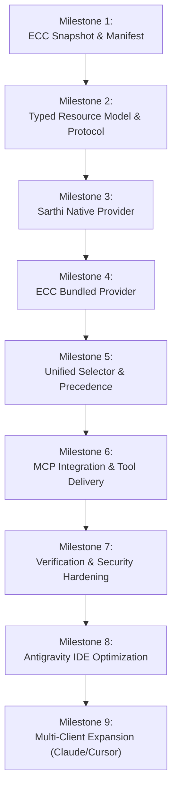

# ECC Integration Roadmap: Staged Implementation Plan

> **Document:** `docs/architecture/ECC_INTEGRATION_ROADMAP.md`  
> **Status:** Implementation Baseline  
> **Target Project:** Sarthi (evolving from ForgeCore)  
> **Upstream Baseline:** ECC v2.2.3 (Commit `b38be6a`)  
> **Author:** Principal Software Architect & Senior Python Systems Engineer  

---

## 1. Roadmap Overview & Phasing Principles

The integration of Everything Claude Code (ECC) into Sarthi must be strictly incremental. To prevent regressions in existing verification capabilities, the roadmap is divided into **9 ordered milestones**.

### Core Execution Rules
1. **Never combine milestones:** Each milestone must be executed, tested, and committed independently.
2. **Zero Breaking Changes:** Existing CLI commands (`init`, `verify`, `standards`), MCP tools, and 85 standards must remain passing after every milestone.
3. **No Unapproved Execution:** Do not introduce dynamic script execution or untrusted hooks.

---

## 2. Detailed Milestone Specifications

---

### Milestone 1: ECC Snapshot Acquisition, Licensing & Manifest
- **Objective:** Curate the official ECC v2.2.3 snapshot (`b38be6a`), establish the static bundled directory structure under `resources/ecc/`, preserve the MIT license, and generate an immutable `manifest.json`.
- **Files / Modules Impacted:**
  - `resources/ecc/manifest.json` (New)
  - `resources/ecc/LICENSE` (New)
  - `resources/ecc/NOTICE` (New)
  - `resources/ecc/rules/` (New)
  - `resources/ecc/skills/` (New)
  - `resources/ecc/agents/` (New)
  - `resources/ecc/workflows/` (New)
  - `resources/ecc/contexts/` (New)
  - `NOTICE` (Updated in repo root)
  - `pyproject.toml` (Updated to package `resources/` data)
- **Dependencies:** None.
- **Tests Required:**
  - `test_ecc_manifest_schema`: Asserts `manifest.json` conforms to schema with valid SHA `b38be6a`.
  - `test_ecc_bundle_integrity`: Asserts all paths listed in `manifest.json` physically exist on disk.
  - `test_ecc_license_preservation`: Asserts `LICENSE` and `NOTICE` are present and valid.
- **Risks:** Bloating the wheel package size with excessive unneeded scripts. (Mitigated by bundling only curated 158 artifacts).
- **Acceptance Criteria:**
  - Directory `resources/ecc/` is populated with curated static files.
  - No shell scripts (`bin/`) or unsandboxed memory files are included.
  - Package builds cleanly with `uv build` including resources.

---

### Milestone 2: Typed Resource Model & Provider Abstraction
- **Objective:** Define the strongly typed Pydantic models for `EngineeringResource`, `ResourceType`, `CompatibilityStatus`, `TrustLevel`, and the `KnowledgeProvider` Protocol.
- **Files / Modules Impacted:**
  - `src/forgecore/core/resources/models.py` (New)
  - `src/forgecore/core/resources/base.py` (New: Provider Protocol)
  - `src/forgecore/core/resources/__init__.py` (New)
- **Dependencies:** Milestone 1.
- **Tests Required:**
  - `test_resource_model_serialization`: Serializes and deserializes all 8 resource types.
  - `test_resource_provenance_validation`: Asserts valid version and commit metadata.
  - `test_provider_protocol_runtime_check`: Confirms protocol conformance.
- **Risks:** Over-complicating metadata fields. (Mitigated by including only fields required for selection, provenance, and trust).
- **Acceptance Criteria:**
  - Typed models defined and passing `ruff check` and strict Pydantic validation.
  - Existing `src/forgecore/core/models.py` remains 100% untouched and backward-compatible.

---

### Milestone 3: Sarthi Native Provider Implementation
- **Objective:** Implement `SarthiNativeProvider` conforming to `KnowledgeProvider`, wrapping the existing 85 YAML rules in `standards/` and the 16-point Core Contract.
- **Files / Modules Impacted:**
  - `src/forgecore/core/providers/native.py` (New)
  - `src/forgecore/core/providers/__init__.py` (New)
- **Dependencies:** Milestone 2.
- **Tests Required:**
  - `test_native_provider_loads_all_85_rules`: Verifies exactly 85 rules are loaded as `EngineeringResource(type=RULE)`.
  - `test_native_provider_contract`: Verifies 16-point Core Contract retrieval.
  - `test_native_provider_layer_filtering`: Verifies layer filtering parity with legacy `RuleLoader`.
- **Risks:** Semantic mapping errors between legacy `Rule` and new `EngineeringResource`.
- **Acceptance Criteria:**
  - `SarthiNativeProvider.list_resources()` returns all 85 standards with `TrustLevel.VERIFIED_NATIVE`.
  - Zero modification to files in `standards/`.

---

### Milestone 4: ECC Bundled Provider Implementation
- **Objective:** Implement `ECCBundledProvider` conforming to `KnowledgeProvider`, reading the bundled catalog from `resources/ecc/` and parsing Markdown frontmatter for skills, rules, agents, and workflows.
- **Files / Modules Impacted:**
  - `src/forgecore/core/providers/ecc.py` (New)
  - `src/forgecore/core/providers/registry.py` (New: ProviderRegistry)
- **Dependencies:** Milestone 1, Milestone 2.
- **Tests Required:**
  - `test_ecc_provider_loads_bundled_skills`: Confirms all curated skills are indexed with metadata.
  - `test_ecc_provider_agent_personas`: Confirms agent personas are loaded with role descriptors.
  - `test_ecc_provider_offline_operation`: Simulates zero network access; asserts 100% catalog availability.
  - `test_ecc_provider_pathguard_containment`: Asserts provider cannot be tricked into reading files outside `resources/ecc/`.
- **Risks:** Inconsistent frontmatter schemas in upstream Markdown files.
- **Acceptance Criteria:**
  - `ECCBundledProvider` discovers, indexes, and serves all 158 bundled ECC resources offline.
  - Read access is strictly contained within `resources/ecc/`.

---

### Milestone 5: Unified Resource Selector, Precedence & Budgeting
- **Objective:** Implement the `UnifiedResourceSelector` that combines resources across providers, resolves conflicts via the strict precedence hierarchy (Security > Native > ECC), and enforces the 3,000-token budget.
- **Files / Modules Impacted:**
  - `src/forgecore/core/resources/selector.py` (New)
  - `src/forgecore/core/resources/precedence.py` (New)
  - `src/forgecore/core/budget.py` (Updated to handle typed resources)
- **Dependencies:** Milestone 3, Milestone 4.
- **Tests Required:**
  - `test_precedence_native_over_ecc`: Confirms native deterministic rules override conflicting ECC guidelines.
  - `test_budget_manager_enforces_token_cap`: Confirms combined payload never exceeds 3,000 estimated tokens.
  - `test_stack_filtering_accuracy`: Asserts FastAPI tasks receive only FastAPI/Python/Universal resources.
  - `test_superseded_rule_exclusion`: Confirms superseded resources are cleanly filtered.
- **Risks:** Token estimation errors causing context saturation. (Mitigated by defensive truncations and token estimation audits).
- **Acceptance Criteria:**
  - `UnifiedResourceSelector.select_resources(stack, task, max_items)` produces a ranked, deduplicated, budget-capped list.
  - Native verification rules retain unconditional priority.

---

### Milestone 6: MCP Integration & Resource Delivery
- **Objective:** Connect the Unified Resource Selector to MCP Tool Handlers (`tools.py`) and MCP Resources (`resources.py`), exposing ECC intelligence to AI coding agents over stdio.
- **Files / Modules Impacted:**
  - `src/forgecore/mcp/tools.py` (Updated to call ResourceSelector)
  - `src/forgecore/mcp/resources.py` (Updated with `sarthi://` and `forgecore://` URIs)
  - `src/forgecore/mcp/server.py` (Maintains tool registration)
- **Dependencies:** Milestone 5.
- **Tests Required:**
  - `test_mcp_get_standards_returns_hybrid_intelligence`: Asserts `get_standards` returns both native rules and ECC skills.
  - `test_mcp_get_workflow_returns_ecc_flow`: Asserts procedural workflows are rendered with fenced commands.
  - `test_mcp_fencing_on_ecc_content`: Confirms all delivered ECC text is wrapped in `<untrusted_project_data>`.
  - Full `tests/integration/test_mcp_server.py` pass.
- **Risks:** Breaking existing MCP tool contracts for connected IDE clients.
- **Acceptance Criteria:**
  - Existing tools (`initialize_project`, `get_standards`, `get_workflow`, `verify_project`) retain identical signatures.
  - AI agents receive rich procedural skills alongside deterministic rules.

---

### Milestone 7: Verification & Security Hardening
- **Objective:** Ensure the deterministic verification engine (`Verifier`, `Runners`) remains completely insulated from external prompts and enforce PathGuard sandboxing over all resource access.
- **Files / Modules Impacted:**
  - `src/forgecore/core/verify/verifier.py`
  - `src/forgecore/core/verify/trust.py`
  - `src/forgecore/core/pathguard.py`
- **Dependencies:** Milestone 6.
- **Tests Required:**
  - `test_verifier_unaffected_by_ecc_skills`: Asserts that adding 150+ skills does not alter verifier exit codes.
  - `test_pathguard_blocks_arbitrary_resource_paths`: Traversal test against resource endpoints.
  - `test_interactive_tty_approval_uncompromised`: Confirms `forgecore approve` still requires interactive TTY.
- **Risks:** Unintended permission widening.
- **Acceptance Criteria:**
  - Zero changes to allowlisted executables.
  - Deterministic test and lint gates continue to hard-block invalid code.

---

### Milestone 8: Antigravity IDE Optimization
- **Objective:** Optimize the Antigravity integration adapter to advertise Sarthi capabilities, configure prompt sidecars, and align with Antigravity customization discovery.
- **Files / Modules Impacted:**
  - `src/forgecore/adapters/antigravity/adapter.py`
  - `docs/antigravity-notes.md`
- **Dependencies:** Milestone 6.
- **Tests Required:**
  - `test_antigravity_adapter_roundtrip`: Confirms install/uninstall byte-identical restoration.
  - `test_antigravity_manifest_tracks_resources`: Validates manifest tracking.
- **Risks:** Conflicts with pre-existing `GEMINI.md` configurations.
- **Acceptance Criteria:**
  - Timestamped backups (`.bak`) continue to protect user configurations.
  - Server cleanly advertises ECC capabilities in Antigravity chat.

---

### Milestone 9: Multi-Client Adapter Expansion (Future Target)
- **Objective:** Implement client adapters for Claude Code (`~/.claude/`), Cursor (`.cursorrules`), and VS Code, providing universal access to Sarthi's hybrid knowledge and verification engine.
- **Files / Modules Impacted:**
  - `src/forgecore/adapters/claude_code/` (New)
  - `src/forgecore/adapters/cursor/` (New)
  - `src/forgecore/cli.py` (New subcommands: `install claude`, `install cursor`)
- **Dependencies:** Milestone 7.
- **Acceptance Criteria:**
  - Seamless installation across Claude Code, Cursor, and Antigravity.

---

## 3. Milestone Summary & Progress Tracker

| Milestone | Title | Impacted Modules | Status | Target Phase |
|---|---|---|---|---|
| **M1** | ECC Snapshot, Licensing & Manifest | `resources/ecc/`, `pyproject.toml` | **Ready for Execution** | Phase 1 |
| **M2** | Typed Resource Model & Protocol | `core/resources/` | Planned | Phase 1 |
| **M3** | Sarthi Native Provider | `core/providers/native.py` | Planned | Phase 1 |
| **M4** | ECC Bundled Provider | `core/providers/ecc.py` | Planned | Phase 1 |
| **M5** | Unified Selector & Budgeting | `core/resources/selector.py` | Planned | Phase 1 |
| **M6** | MCP Integration & Tool Delivery | `mcp/tools.py`, `mcp/resources.py` | Planned | Phase 1 |
| **M7** | Verification & Security Hardening | `core/verify/`, `pathguard.py` | Planned | Phase 1 |
| **M8** | Antigravity IDE Optimization | `adapters/antigravity/` | Planned | Phase 2 |
| **M9** | Multi-Client Expansion | `adapters/claude_code/`, `cursor/` | Planned | Phase 2 |
