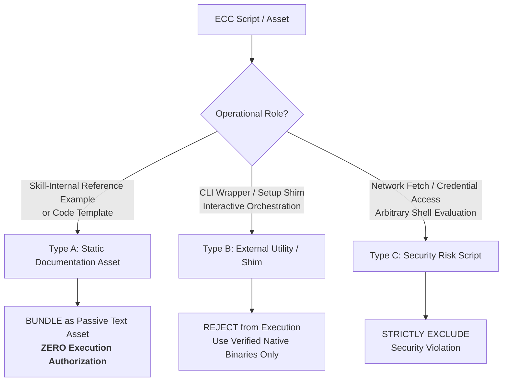

# ECC Resource Inventory & Compatibility Evaluation

> **Document:** `docs/architecture/ECC_RESOURCE_INVENTORY.md`  
> **Status:** Reconciled Resource Audit  
> **Target Baseline:** Everything Claude Code (ECC) v2.2.3  
> **Authoritative Commit SHA:** `c05b2d6614f62f6db0047669aa4eefb223d478f9` (abbreviated `c05b2d6`)  
> **Release Tag Object SHA:** `93f9f6154d164ccb9f4dc38858a2bc2d5dcab222`  
> **Upstream Repository:** `https://github.com/affaan-m/ECC`  
> **Upstream Author:** Affaan Mustafa  
> **License:** MIT License  

---

## 1. Executive Summary

This document establishes the reconciled technical inventory and integration classification of resources in **Everything Claude Code (ECC) v2.2.3**.

ECC v2.2.3 represents a comprehensive collection of AI coding agent harnesses. However, **not all ECC resources can or should be integrated into Sarthi**. Sarthi's architectural mandate requires strict deterministic verification, offline bundling, and client safety. Therefore, every resource category in ECC is evaluated and assigned an explicit integration decision:

- **BUNDLE & DELIVER:** Bundled locally into `resources/ecc/` and exposed via MCP tools and resources.
- **ADAPT:** Ingested and transformed to conform to Sarthi schemas and host IDE constraints.
- **PASSIVE REFERENCE ASSET:** Bundled strictly as read-only static documentation with **zero execution authorization**.
- **DEFER:** Excluded from Milestone 1; cataloged for future phased integration (Phase 2).
- **REJECT:** Excluded permanently due to security risks or architectural incompatibility.

---

## 2. Upstream Snapshot Provenance & Metadata

- **Upstream Repository:** `https://github.com/affaan-m/ECC` (formerly `affaan-m/everything-claude-code`)
- **Release Version:** `v2.2.3` (Release Date: October 1, 2026)
- **Authoritative Commit SHA:** `c05b2d6614f62f6db0047669aa4eefb223d478f9` (abbreviated `c05b2d6`)
- **Release Tag Object SHA:** `93f9f6154d164ccb9f4dc38858a2bc2d5dcab222`
- **Reconciliation Note on `b38be6a`:** The previous preliminary report cited commit `b38be6a`. Verification against `git ls-remote` confirms that `b38be6a` was a later post-release commit on `main` (PR #3809, merged October 29/30, 2026), whereas `c05b2d6` is the true commit tagged by release `v2.2.3`. `c05b2d6` is the definitive baseline.
- **Upstream Release Focus:** Standardized project branding to ECC, hardened release CI/CD verification against npm registries, stabilized profile configurations (`pi/core`), and unified skill metadata.
- **Catalog Scope:** Upstream contains 311 total skills (123 curated in the `pi/core` profile), 14 domain rule packs, ~71 sub-agent definitions, 24 prompt commands in `pi/core/commands/` (~97 command shims across profiles), 8 workflows, 12 context briefs, 24 Hookify rules, and supporting scripts.
- **License Terms:** MIT License (requires preservation of original copyright notice in all bundled distributions).

---

## 3. High-Level Category Evaluation Matrix

| Resource Category | Upstream Total (v2.2.3) | Curated Scope (`pi/core`) | Primary Upstream Purpose | Sarthi Integration Decision | Host Target Support | Key Constraints & Security Policy |
|---|---|---|---|---|---|---|
| **Rules** | 14 rule packs | 14 packs | Domain and language coding standards | **BUNDLE & DELIVER** | IDE-Agnostic | Markdown/YAML frontmatter; mapped to Sarthi `RULE` type. Advisory to Tier 1-3. |
| **Skills** | 311 total | 123 core skills | Procedural engineering recipes | **BUNDLE & DELIVER** | IDE-Agnostic | Markdown instructions; dynamic token budgeting (<3,000 tokens). |
| **Prompt Commands** | ~97 commands | 24 core commands | Slash command prompt macros | **BUNDLE & DELIVER** | IDE-Agnostic | Mapped to `COMMAND` type; delivered as structured prompt templates. |
| **Agent Personas** | ~71 definitions | 24 core personas | Specialized sub-agent task roles | **ADAPT & DELIVER** | Antigravity / Claude Code | Mapped to `AGENT` type; delivered as role prompts or subagent configs. |
| **Workflows** | 8 core workflows | 8 workflows | Multi-stage task lifecycle processes | **ADAPT & DELIVER** | IDE-Agnostic | Replaces static Jinja2 templates; must fence project commands. |
| **Contexts** | 12 context briefs | 12 briefs | Stack and architectural reference briefs | **BUNDLE & DELIVER** | IDE-Agnostic | Delivered as reference resources (`sarthi://context/...`). |
| **Supporting Scripts** | Diverse utility scripts | Selected skill scripts | Code examples and helper scripts | **PASSIVE REFERENCE ASSET** | Documentation / Manual | **Zero Execution Authorization.** Bundled strictly as read-only text. |
| **Hooks (Hookify)** | 24 hook rules | Deferred | Runtime command/edit interception | **DEFER (Phase 2)** | Host-Dependent (Node/CLI) | Requires active execution daemon; deferred to avoid premature automation. |
| **AgentShield** | 1 security suite | Deferred | Permission manifest auditor | **DEFER (Phase 2)** | External Tool / CI | Requires Node runtime; scheduled as verification runner in Phase 2. |
| **Executable Shims** | 97 command shims | Excluded | Shell wrappers & local CLI shims | **REJECT** | Host-Specific | Security hazard. Sarthi forbids executing untrusted shell wrappers. |
| **MCP Configs** | 16 server configs | Deferred | External SaaS API connectors | **DEFER** | IDE-Dependent | Connects to external services; outside core local guardrail scope. |

---

## 4. Detailed Component Inventory & Curation

### 4.1 Selected Resources: Rules (Core Coding Standards)
ECC rules provide clean, domain-specific coding guidelines that directly augment Sarthi's declarative standards:

| Resource ID | Origin Path in ECC | Target Domain | Integration Strategy | Technical Justification |
|---|---|---|---|---|
| `ecc.rule.typescript` | `rules/typescript.md` | TypeScript / Node | **Bundle** | Standardizes strict typing, error handling, and modern ES syntax. |
| `ecc.rule.python` | `rules/python.md` | Python Ecosystem | **Bundle** | Enforces PEP 8, typing annotations, and async discipline. |
| `ecc.rule.react` | `rules/react.md` | React / Next.js | **Bundle** | Enforces component isolation, hook discipline, and SSR safety. |
| `ecc.rule.fastapi` | `rules/fastapi.md` | FastAPI Web APIs | **Bundle** | Complements Sarthi's `fastapi` layer with dependency injection patterns. |
| `ecc.rule.security` | `rules/security.md` | OWASP / Security | **Bundle** | Reinforces input sanitization, CSRF, and secret handling. |
| `ecc.rule.git` | `rules/git.md` | Version Control | **Bundle** | Standardizes Conventional Commits and clean PR discipline. |
| `ecc.rule.testing` | `rules/testing.md` | Automated Testing | **Bundle** | Mandates unit, integration, and property-based test patterns. |
| `ecc.rule.database` | `rules/database.md` | SQL / Migrations | **Bundle** | Enforces schema migration discipline and indexing rules. |

### 4.2 Selected Resources: Skills (Procedural Engineering Guides)
Skills represent the highest-value procedural component of ECC. In Milestone 1, Sarthi bundles the **123 curated core skills** (`pi/core` profile):

| Domain Cluster | Key Skills Included | Delivery Mechanism | Token Impact & Budgeting |
|---|---|---|---|
| **Test-Driven Development (TDD)** | `tdd-workflow`, `pytest-patterns`, `jest-vitest-recipes`, `mocking-strategies` | `get_standards()` / `get_workflow()` | Ingested on demand; truncated if combined size exceeds 3,000 tokens. |
| **API Architecture** | `rest-api-design`, `fastapi-advanced`, `pydantic-v2-patterns`, `graphql-schema` | `get_standards()` | Selected when `api-design` or `fastapi` layers are active. |
| **Frontend Engineering** | `react-state-management`, `react-performance`, `tailwind-styling`, `a11y-audit` | `get_standards()` | Selected when `react` or `react-native` layers are active. |
| **Backend & Cloud** | `docker-best-practices`, `postgresql-optimization`, `redis-caching`, `jwt-auth` | `get_standards()` | Selected based on task keyword matching. |
| **Refactoring & Clean Code** | `legacy-refactoring`, `code-smells-remediation`, `solid-principles` | `get_workflow(task_type="refactor")` | Automatically attached to refactoring task lifecycles. |

### 4.3 Selected Resources: Prompt Commands (`pi/core/commands/`)
The upstream `pi/core` profile defines 24 prompt commands (slash commands) that instruct agents to perform targeted operations. In Sarthi, these are categorized as `COMMAND` resources:

| Command ID | Origin Path in ECC | Primary Instruction Purpose | Sarthi MCP Delivery |
|---|---|---|---|
| `ecc.command.review` | `pi/core/commands/review.md` | Structured pre-commit code review prompt | Delivered via MCP prompt / `get_workflow()` |
| `ecc.command.tdd` | `pi/core/commands/tdd.md` | Strict TDD cycle driver instruction | Delivered via `get_workflow(task_type="feature")` |
| `ecc.command.audit` | `pi/core/commands/audit.md` | Security and vulnerability audit prompt | Delivered via `get_standards(layers=["security"])` |
| `ecc.command.refactor` | `pi/core/commands/refactor.md` | Safe step-by-step refactoring prompt | Delivered via `get_workflow(task_type="refactor")` |

### 4.4 Selected Resources: Specialized Agent Personas (`agents/`)
ECC includes specialized agent definitions in `agents/`. Sarthi indexes 24 curated role definitions as **role-based planning templates** (`AGENT` type):

| Agent ID | Origin Path in ECC | Role / Specialization | Antigravity Host Mapping | Delivery Mechanism |
|---|---|---|---|---|
| `ecc.agent.planner` | `agents/planner.md` | Architecture & Feature Planning | Session Planning Phase | Delivered via `get_workflow(task_type="feature")` |
| `ecc.agent.code-reviewer` | `agents/code-reviewer.md` | Code Review & Audit | Pre-Verification Phase | Delivered via `get_workflow()` check phase |
| `ecc.agent.security-auditor` | `agents/security-auditor.md` | Vulnerability & Permission Audit | Security Layer | Delivered when security tasks are active |
| `ecc.agent.test-lead` | `agents/test-lead.md` | Test Suite Design & Edge Cases | Testing Layer | Delivered when test generation is requested |
| `ecc.agent.build-repair` | `agents/build-repair.md` | Diagnostic & Error Recovery | Verification Remediation | Delivered when `verify_project` reports failures |

### 4.5 Selected Resources: Workflows
ECC multi-stage workflows in `workflows/` are adapted to replace Sarthi's static Jinja2 templates:
- **`feature-flow`:** Plan -> Interface Contract -> Test Scaffold -> Implement -> Verify -> Document.
- **`bugfix-flow`:** Failing Reproduction Test -> Root Cause Analysis -> Atomic Patch -> Regression Verification.
- **`refactor-flow`:** Invariant Test Baseline -> Incremental Decoupling -> Verification Loop.

---

## 5. Script Reassessment & Classification

The preliminary architecture applied a blanket rejection to all scripts. A rigorous reassessment categorizes scripts by operational role, side effects, and risk:



### 5.1 Script Taxonomy & Sarthi Policy

1. **Type A: Skill-Internal Supporting Documentation & Code Templates:**
   - *Characteristics:* Reference Python/JS files located inside skill folders illustrating algorithms, configuration templates, or mock patterns. No credential access, no external network calls, no system mutation.
   - *Sarthi Policy:* **Bundle as Read-Only Static Text Assets.** Exposed strictly as documentation references in `resources/ecc/scripts/` or embedded in skills.
   - *Execution Rule:* **ZERO runtime execution authorization.** Neither Sarthi nor the MCP server will execute these scripts.
2. **Type B: Interactive / External Utility Scripts & Automation Runners:**
   - *Characteristics:* Shell scripts (`.sh`, `.bat`) and Node CLI shims in `bin/` or `scripts/` designed to configure host environments, wrap npm/pip commands, or manage git hooks.
   - *Sarthi Policy:* **Excluded from Autonomous Execution.** AI agents must not run unverified third-party shell wrappers. Sarthi relies strictly on verified native tools (`ruff`, `pytest`, `eslint`, `semgrep`).
3. **Type C: Security Risk Scripts:**
   - *Characteristics:* Scripts that invoke `curl | sh`, inspect environment variables for credentials, modify system PATH, or download remote assets.
   - *Sarthi Policy:* **Permanently Rejected and Excluded.** Violates Tier 1 security boundaries.

---

## 6. Antigravity Compatibility Evaluation

A core requirement is establishing exact compatibility between ECC resource formats and the **Antigravity IDE** host agent environment:

| ECC Resource Format | Antigravity Native Capability | Compatibility Assessment | Sarthi Delivery Path |
|---|---|---|---|
| **Rules (`rules/*.md`)** | Native Rules (`GEMINI.md`, `.agents/rules/*.md`) | **100% Compatible** | Delivered via MCP `get_standards()` and formatted into rule text. |
| **Skills (`skills/*/SKILL.md`)** | Native Skills (`SKILL.md` folders) | **100% Compatible** | Ingested by MCP server; formatted into procedural guidelines with budget capping. |
| **Workflows (`workflows/*.md`)** | Markdown Execution Plans | **100% Compatible** | Delivered via MCP `get_workflow()` with fenced project verification commands. |
| **Prompt Commands (`commands/*.md`)** | Slash Commands / System Prompts | **Adapted (Prompt Template)** | Delivered as structured prompt macros over MCP or prompt endpoints. |
| **Agent Personas (`agents/*.md`)** | Subagents (`define_subagent` / `invoke_subagent`) | **Adapted & Delegated** | Delivered as role persona instructions in MCP; subagents spawned via host tools if supported. |
| **Generic Reference Markdown** | Markdown Chat Context | **100% Compatible** | Exposed via MCP resource URIs (`sarthi://context/...`). |
| **Hookify Dynamic Hooks** | Customization Hooks (`hooks.json`) | **Deferred (Phase 2)** | Deferred; host hooks require standalone validation before enablement. |
| **External MCP Connectors** | Sidecar MCP Servers (`mcp_config.json`) | **Deferred** | Kept outside core local guardrails to prevent external service coupling. |

---

## 7. Deferred & Rejected Resources

### 7.1 Deferred to Phase 2 (Runtime & Tooling Dependencies)
1. **Hookify Lifecycle Hooks (`hooks/`):**
   - *Reason for Deferral:* Requires a continuously running Node runtime or native IDE interception hook. Milestone 1 focuses strictly on deterministic verification and MCP delivery.
2. **AgentShield Security Scanner:**
   - *Reason for Deferral:* AgentShield is an external TypeScript CLI (`npx ecc-agentshield`). Sarthi's core verification engine is Python-native. In Phase 2, AgentShield will be evaluated as an optional runner alongside ESLint and Ruff.
3. **External MCP Configurations (`mcp/`):**
   - *Reason for Deferral:* Connects to external SaaS APIs (Linear, GitHub, Figma). Sarthi's primary purpose is local codebase guardrails.

### 7.2 Rejected Resources (Permanent Security Exclusion)
1. **Executable Shell Shims (`bin/`, `scripts/*.sh`):**
   - *Reason for Rejection:* Executing unverified third-party shell scripts inside the user's project violates Sarthi's core security model (`PathGuard` and executable allowlist).
2. **Unsandboxed Memory State (`.claude/memory/`):**
   - *Reason for Rejection:* Dynamic prompt memory files are treated as untrusted project data. They are never ingested as executable policy or allowed to bypass verification gates.

---

## 8. Licensing & Attribution Strategy

ECC is licensed under the **MIT License** by Affaan Mustafa. Strict compliance with the MIT License is mandatory:

1. **Bundled License Preservation:** The upstream `LICENSE` file is copied verbatim to `resources/ecc/LICENSE`.
2. **Attribution in `NOTICE`:** The repository's root `NOTICE` file is updated with explicit attribution:
   ```
   This product includes software developed as part of Everything Claude Code (ECC)
   by Affaan Mustafa (https://github.com/affaan-m/ECC).
   Licensed under the MIT License.
   Bundled Snapshot: v2.2.3 (Commit c05b2d6614f62f6db0047669aa4eefb223d478f9)
   ```
3. **Header Preservation:** Any ECC rule, skill, or workflow containing original author attribution or copyright comments retains those comments without modification.
4. **Independent Authorship Distinction:** All Sarthi core code (`src/sarthi/`), verification runners, `PathGuard`, and native standards (`standards/`) remain independently authored by the Sarthi / Sarthi development team.

---

## 9. Reconciled Resource Ingestion Summary

```
+-----------------------------------------------------------------------------------------+
|                              RECONCILED ECC INGESTION SUMMARY                           |
+-----------------------------------------------------------------------------------------+
| Upstream Total Resources Evaluated (v2.2.3 @ c05b2d6):     ~536 artifacts               |
| --------------------------------------------------------------------------------------- |
| - Bundled & Delivered (Core Skills, Rules, Commands, Workflows, Contexts): 181 artifacts|
|     * Skills (pi/core curated):                               123 artifacts             |
|     * Prompt Commands (pi/core commands):                      24 artifacts             |
|     * Domain Rule Packs:                                       14 artifacts             |
|     * Core Workflows:                                           8 artifacts             |
|     * Reference Context Briefs:                                12 artifacts             |
| - Adapted for MCP Delivery (Agent Persona Prompts):            24 artifacts             |
| - Bundled as Passive Reference Assets (Type A Scripts):        ~15 artifacts (NO EXEC)  |
| - Deferred to Phase 2 (Hooks, AgentShield, MCP configs):       41 artifacts             |
| - Rejected from Execution (Executable Shims, Shell Scripts):   ~275 artifacts           |
+-----------------------------------------------------------------------------------------+
```
