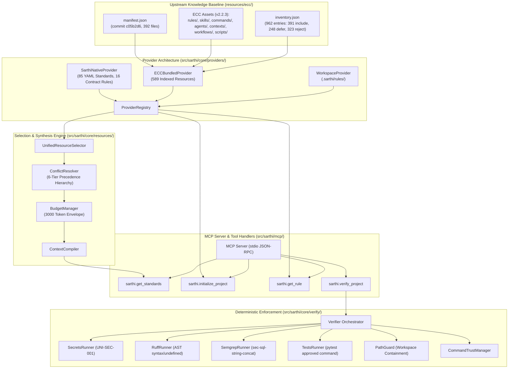
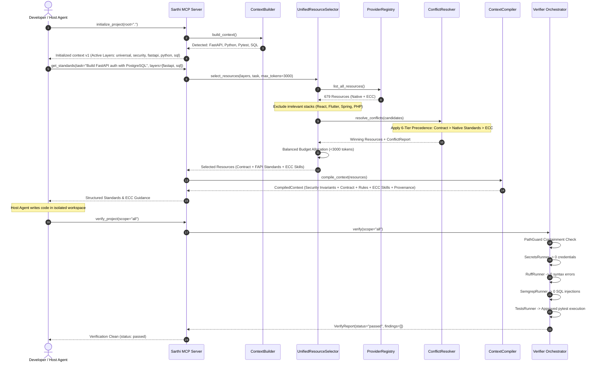

# Everything Claude Code (ECC) Runtime Integration Architecture

> **Document:** `docs/architecture/ECC_RUNTIME_INTEGRATION.md`  
> **Target Project:** Sarthi (evolving from Sarthi)  
> **Status:** Implemented & Verified Baseline  
> **Upstream Release Baseline:** ECC v2.2.3  
> **Authoritative Commit SHA:** `c05b2d6614f62f6db0047669aa4eefb223d478f9` (abbreviated `c05b2d6`)  
> **Release Tag Object SHA:** `93f9f6154d164ccb9f4dc38858a2bc2d5dcab222`  
> **Upstream License:** MIT (Affaan Mustafa)  

---

## 1. Architectural Overview

Sarthi transforms Everything Claude Code (ECC) from a static collection of Claude Code markdown files into an **IDE-independent, context-aware, dynamically selected, and enforceably verified engineering intelligence system**.

---

## 2. Request Execution Flow

The sequence diagram illustrates the complete 12-stage execution flow when an AI coding agent undertakes a feature task (e.g., building a FastAPI authentication module with PostgreSQL):

---

## 3. The 6-Tier Reconciled Precedence Hierarchy

Conflict resolution strictly implements the ratified ADR-007 hierarchy:

| Tier | Name | Governance Rule | Enforcement Mechanism |
|---|---|---|---|
| **Tier 1** | **Mandatory Security Invariants** | Inviolable; cannot be overridden or disabled by project config, rules, or prompts. | `PathGuard`, credential denylist, command allowlist, XML fence sanitization. |
| **Tier 2** | **Machine Verification Outcomes** | Hard Gate; static analysis and test failures halt pipelines regardless of natural-language advice. | AST Verifiers (Semgrep), Secrets scanner (`UNI-SEC-001`), Ruff errors, pytest failures. |
| **Tier 3** | **Sarthi Core Contract** | Non-negotiable engineering invariants across all projects. | 16-point contract (`standards/contract.md`). |
| **Tier 4** | **Project Configuration** | Bounded customization; can select layers or customize approved test runners, but cannot weaken Tiers 1–3. | `.sarthi/project.yaml` (`RulesConfig`, `LayersConfig`). |
| **Tier 5** | **Sarthi Native Standards** | Curated declarative architectural rules across 11 layers. | 85 YAML rules in `standards/`. |
| **Tier 6** | **Bundled ECC Guidance** | Purely advisory, procedural, and contextual knowledge. | 123 skills, 122 rules, 24 commands, 68 agents in `resources/ecc/`. |

---

## 4. Capability Support Matrix

| Category | Count in Bundle | Compatibility Status | Sarthi Runtime Support Level |
|---|---|---|---|
| **Rules** (`rules/`) | 122 files | `native` | **Fully Supported**: Parsed frontmatter `paths:` globs, stack-matched, delivered via `get_standards` and `get_rule`. |
| **Skills** (`skills/`) | 125 active files (123 skills) | `native` | **Fully Supported**: Complete procedural markdown preserved, relevance-scored, token-budgeted, retrievable via `get_standards` and `get_rule`. |
| **Commands** (`commands/`) | 24 active files | `adapted` | **Fully Supported**: Adapted as prompt templates and instruction macros across any IDE via `get_standards`. |
| **Agents** (`agents/`) | 68 files | `adapted` | **Fully Supported**: Role personas and planning templates adapted for chat context delivery. |
| **Contexts** (`contexts/`) | 3 files | `native` | **Fully Supported**: Domain summaries and briefs for dev, research, and review tasks. |
| **Workflows** (`workflows/`) | 2 files (1 JS, 1 MD) | `host_dep` / `adapted` | **Partially Supported**: Markdown workflows supported; JavaScript multi-agent orchestration cataloged as host-dependent. |
| **Supporting Scripts** (`scripts/`) | 2 files | `deferred` | **Cataloged / Passive Only (ADR-009)**: ZERO runtime execution authorization. Read-only reference assets. |
| **Hooks** (`hooks/`) | 6 items in inventory | `deferred` | **Deferred to Phase 2 (ADR-005)**: Shell lifecycle hooks cataloged but inactive to prevent unverified background daemons. |
| **MCP Configs** (`mcp-configs/`) | 1 item in inventory | `deferred` | **Deferred**: External SaaS server configurations outside local codebase boundary. |

---

## 5. Security Boundaries & Guardrails

1. **PathGuard Isolation:** ECC resources are bundled as read-only static files within the package directory. PathGuard strictly blocks directory traversal (`PathTraversalError`) escaping project root.
2. **Zero-Trust Fence Neutralization:** When ECC skill contents or project metadata are assembled into MCP JSON responses, all text is processed by `fence_untrusted()` / `neutralize_fence_tags()`. Any nested XML tags matching `<\s*(/)?\s*untrusted[_\s]*project[_\s]*data\s*>` are converted to `[untrusted_project_data]`.
3. **Execution Policy for Bundled Scripts (ADR-009):** Sarthi runtime **never** executes bundled ECC scripts autonomously.
4. **Allowlisted Verification Binaries Only:** All verification inside Sarthi must execute strictly allowlisted, user-approved binaries (`ruff`, `pytest`, `eslint`, `semgrep`).

