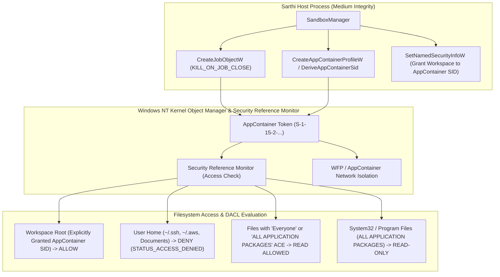
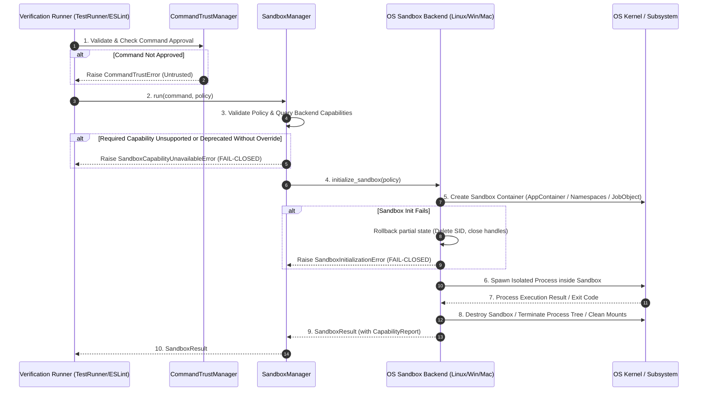
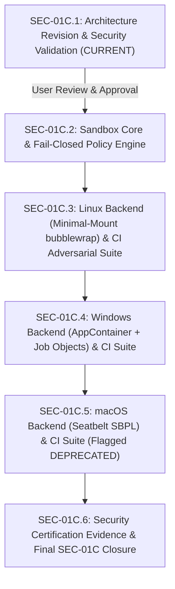

# SEC-01C: OS-Level Subprocess Sandbox Architecture & Threat Model

**Status:** REVISED ARCHITECTURAL SPECIFICATION (SEC-01C.1 - Final Accuracy Revision)  
**Document Version:** 2.3.0  
**Author:** Principal Security Architect, OS Security Engineer & CI Test Architect  
**Base Commit:** `10ff6e67147abda7eb54cc929073f88bd875b39b`  
**Target Milestone:** SEC-01C (OS-Level Subprocess Sandbox Isolation)  

---

## 1. Executive Summary & Fundamental Security Gap

Sarthi currently implements multiple application-layer security mechanisms:
- **`PathGuard`** ([`src/sarthi/core/pathguard.py`](file:///C:/Users/Rajendra/Desktop/Projects/ForgeCore/src/sarthi/core/pathguard.py)): Pure Python lexical path normalization and containment checking.
- **`CommandTrustManager`** ([`src/sarthi/core/verify/trust.py`](file:///C:/Users/Rajendra/Desktop/Projects/ForgeCore/src/sarthi/core/verify/trust.py#L314)): Interactive user approval gating and SHA-256 command hashing.
- **Environment Sanitization** ([`src/sarthi/core/verify/trust.py`](file:///C:/Users/Rajendra/Desktop/Projects/ForgeCore/src/sarthi/core/verify/trust.py#L94)): Stripping common secrets and API tokens from child process environment dictionaries.
- **Prompt Injection Neutralization** ([`src/sarthi/core/security.py`](file:///C:/Users/Rajendra/Desktop/Projects/ForgeCore/src/sarthi/core/security.py)): XML boundary fencing.

### The Fundamental Security Gap (Why SEC-01C is Open)
Application-layer controls only constrain code that cooperates with Sarthi. When a verification runner executes a command (e.g., `TestRunner` invoking `pytest`, or `ESLintRunner` invoking `eslint`), the resulting child process executes as a native OS process under the developer's normal user security context.

The child process possesses unrestricted access to OS system calls (`open`, `read`, `write`, `socket`, `connect`, `CreateProcess`, `fork`, `execve`). An AI coding agent that generates an adversarial test suite (`test_exploit.py`, `conftest.py`, or `eslint.config.js`) can:
1. **Access Host Files:** Read private SSH keys (`~/.ssh/id_rsa`), cloud credentials (`~/.aws/credentials`), browser databases, and other workspaces on the host filesystem.
2. **Access Local & Cloud Networks:** Exfiltrate data to remote C2 servers, query unauthenticated local services (`localhost:5432`, `localhost:6379`), or query cloud instance metadata services (`http://169.254.169.254`).
3. **Persist Beyond the Test Lifecycle:** Double-fork, daemonize, or spawn background processes that outlive Sarthi.

**SEC-01C establishes a mandatory, OS-enforced isolation boundary.** Sarthi must not rely on application-level cooperation; isolation must be enforced by the underlying OS kernel.

---

## 2. Complete Subprocess Inventory & Git Security Audit

A repository-wide static audit across production packages (`src/`), evaluation frameworks (`src/sarthi/eval/`), fixtures (`tests/`), and utility scripts (`scripts/`) identified all 14 process-creation call sites:

| # | File Path & Line | Function / Scope | API Invoked | Executable Launched | Input Trust | Code Execution Potential | Current Mitigations | Risk Level | Sandbox Requirement | Architectural Justification |
|---|---|---|---|---|---|---|---|---|---|---|
| 1 | `src/sarthi/core/verify/runners/tests.py:143` | `TestRunner.run` | `subprocess.run` | `pytest`, `npm test`, `mvn test`, `gradle test`, custom commands | **UNTRUSTED** | **YES** (Executes arbitrary Python, JS, Java test code) | `CommandTrustManager`, `build_sanitized_subprocess_env`, timeout (60s) | **CRITICAL** | **MANDATORY (Full Isolation)** | Test suites execute repo-controlled code by design (`conftest.py`, test files, lifecycle scripts). Primary sandbox target. |
| 2 | `src/sarthi/core/verify/runners/eslint.py:53` | `ESLintRunner.run` | `subprocess.run` | `eslint`, `npx eslint` | **PARTIALLY TRUSTED** | **YES** (Executes arbitrary JS in `eslint.config.js`) | `build_sanitized_subprocess_env`, timeout (45s) | **HIGH** | **MANDATORY (Full Isolation)** | Node.js parses configuration files as executable JavaScript. Can execute arbitrary OS syscalls during linting. |
| 3 | `src/sarthi/core/verify/runners/semgrep.py:59` | `SemgrepRunner.run` | `subprocess.run` | `semgrep` CLI | **PARTIALLY TRUSTED** | **NO** (Static rule engine) | `build_sanitized_subprocess_env`, timeout (45s) | **MEDIUM** | **CONDITIONAL (Read-Only FS)** | Static AST/pattern matcher. Low risk of code execution, but must be constrained from reading host credentials. |
| 4 | `src/sarthi/core/verify/runners/ruff.py:75` | `RuffRunner.run` | `subprocess.run` | `ruff check` | **PARTIALLY TRUSTED** | **NO** (Compiled Rust binary) | `build_sanitized_subprocess_env`, batched args, timeout (30s) | **LOW** | **CONDITIONAL (Read-Only FS)** | Compiled native Rust tool. Low risk, but sandboxing provides defense-in-depth against parser vulnerabilities. |
| 5 | `src/sarthi/core/verify/verifier.py:56` | `Verifier._is_git_repo` | `subprocess.run` | `git rev-parse --is-inside-work-tree` | **TRUSTED** | **NO** (Read-only VCS query) | Fixed args, timeout (5s) | **LOW** | **EXEMPT (Tier 1 Sterile)** | Internal repository detection query. Strictly constrained to Tier 1 sterile metadata protocol. |
| 6 | `src/sarthi/core/verify/verifier.py:78` | `Verifier.get_changed_files` | `subprocess.run` | `git diff --name-only HEAD` | **TRUSTED** | **POTENTIAL** (External diff drivers, textconv) | Fixed args, timeout (5s) | **MEDIUM** | **EXEMPT (Tier 1 Sterile)** | VCS query. Requires sterile Tier 1 flags (`--no-ext-diff`, `--no-textconv`, sterile overrides). |
| 7 | `src/sarthi/core/verify/verifier.py:94` | `Verifier.get_changed_files` | `subprocess.run` | `git status --porcelain` | **TRUSTED** | **POTENTIAL** (Git fsmonitor hook) | Fixed args, timeout (5s) | **MEDIUM** | **EXEMPT (Tier 1 Sterile)** | VCS query. Requires sterile Tier 1 overrides against untrusted `core.fsmonitor`. |
| 8 | `src/sarthi/eval/experiment.py:69` | `get_current_commit_sha` | `subprocess.run` | `git rev-parse HEAD` | **TRUSTED** | **NO** (Read-only VCS query) | Fixed args, `check=True` | **LOW** | **EXEMPT (Tier 1 Sterile)** | Evaluation harness metadata tracking. |
| 9 | `src/sarthi/eval/scenarios.py:103-117` | `stage_scenario_workspace` | `subprocess.run` | `git init`, `git config`, `git add`, `git commit` | **TRUSTED** | **POTENTIAL** (Git commit hooks) | Ephemeral directory | **LOW** | **EXEMPT (Tier 1 Sterile / Fixture)** | Fixture setup. Ephemeral directory. |
| 10 | `tests/e2e/fixtures.py:489-508` | `create_login_api_fixture` | `subprocess.run` | `git init`, `git config`, `git add`, `git commit` | **TEST HARNESS** | **NO** (Deterministic test double) | Ephemeral `tmp_path` | **LOW** | **EXEMPT** | E2E fixture generation. |
| 11 | `tests/e2e/test_antigravity_e2e_lifecycle.py:310-329` | `_create_items_fixture` | `subprocess.run` | `git init`, `git config`, `git add`, `git commit` | **TEST HARNESS** | **NO** (Deterministic test double) | Ephemeral `tmp_path` | **LOW** | **EXEMPT** | E2E lifecycle test setup. |
| 12 | `scripts/benchmark_20k.py:24` | `run_benchmark` | `subprocess.run` | Benchmark scripts | **DEV SCRIPT** | **NO** | Manual developer utility | **LOW** | **EXEMPT** | Developer performance harness. |
| 13 | `scripts/measure_startup.py:14` | `measure_startup` | `subprocess.Popen` | `sarthi` CLI | **DEV SCRIPT** | **NO** | Manual developer utility | **LOW** | **EXEMPT** | Startup benchmark. |
| 14 | `scripts/test_real_mcp_stdio_audit.py:24` | `test_stdio` | `subprocess.Popen` | `sarthi serve` | **DEV SCRIPT** | **NO** | Manual developer utility | **LOW** | **EXEMPT** | Real stdio transport audit script. |

---

### In-Depth Git Execution Hardening: Reality & Complete Surface Analysis

Git invocations are frequently assumed to be safe read-only queries. In reality, Git contains numerous configuration-driven hooks, drivers, filters, and environment variables that can execute arbitrary external code even on seemingly benign subcommands.

#### Critical Evaluation of Commonly Proposed Flags:

1. **`-c diff.external=`**:
   - **What it protects against:** Overrides the global or local `diff.external` configuration setting that delegates `git diff` formatting to an arbitrary external executable.
   - **What it does NOT protect against:** Custom diff drivers declared in `.gitattributes` (e.g., `*.py diff=customdriver`) paired with `diff.customdriver.command` or `diff.customdriver.textconv`. It also provides zero protection against merge drivers (`merge.<driver>.driver`) or external tools configured in `.git/config`.

2. **`-c core.fsmonitor=false`**:
   - **What it protects against:** Disables the filesystem monitor IPC hook that Git invokes during status and index refresh operations.
   - **What it does NOT protect against:** Git hooks (`.git/hooks/*`), smudge/clean filters, credential helpers, or alias expansions.

3. **`--no-pager`**:
   - **What it protects against:** Prevents Git from launching an interactive terminal pager binary (e.g., `less`, `more`, or whatever binary is specified by `$GIT_PAGER` or `core.pager`). An interactive pager can allow arbitrary shell command execution via pager escapes (e.g., `!sh` inside `less`).
   - **What it does NOT protect against:** Any non-interactive hook, smudge/clean filter, driver, or background process.

4. **`--no-verify`**:
   - **What it protects against:** Bypasses `pre-commit` and `commit-msg` client-side hooks strictly during `git commit`.
   - **What it does NOT protect against:** Any other Git hook lifecycle point—including `post-checkout`, `post-merge`, `post-rewrite`, `pre-push`, `pre-rebase`, `post-commit`—and it has zero effect on any Git subcommand other than `commit`.

#### Complete Surface Analysis for Untrusted Git Repositories:

- **The Configuration Subsection Wildcard Fallacy:**
  Git's configuration parser does **NOT** support wildcard patterns (`*`) in subsection names when passing `-c <section>.<subsection>.<key>=<value>`.
  Passing `-c filter.*.clean=` sets the key `clean` strictly in a subsection literally named `"*"`. It does **not** override `filter.lfs.clean` or arbitrary named filter drivers configured in `.git/config`! Claims that command-line `-c` flags can wildcard-neutralize all filters are technically invalid.
- **System and Global Git Configuration (`/etc/gitconfig`, `~/.gitconfig`, `$XDG_CONFIG_HOME/git/config`):** Can configure global aliases with shell escapes (`alias.<name> = !<cmd>`), credential helpers, default diff/merge drivers, or transport protocols.
- **Repository-Local Configuration (`.git/config`):** Repositories staged or modified by an agent can contain dangerous directives:
  - `diff.<driver>.command`: Arbitrary binary executed during `git diff`.
  - `diff.<driver>.textconv`: Arbitrary binary executed to convert binary formats during `git diff`.
  - `filter.<driver>.clean` and `filter.<driver>.smudge`: Arbitrary binaries executed on `git add` and `git checkout`.
  - `filter.<driver>.process`: Long-running filter daemons executed on file checkouts.
  - `core.sshCommand`: Arbitrary executable invoked whenever Git uses SSH.
  - `core.hooksPath`: Custom script directory replacing `.git/hooks/`.
- **Credential Helpers (`credential.helper`):** Executed whenever Git attempts authentication or remote URL inspection.
- **Remote Helpers (`git-remote-<protocol>`):** Custom protocols (e.g. `ext::`) invoke external executables.
- **Environment Variables:** `GIT_DIR`, `GIT_WORK_TREE`, `GIT_INDEX_FILE`, `GIT_OBJECT_DIRECTORY`, `GIT_EXEC_PATH`, `GIT_EXTERNAL_DIFF`, `GIT_PAGER`, `GIT_ASKPASS`, `GIT_SSH_COMMAND`, `GIT_CONFIG_PARAMETERS`, etc.

#### Sarthi's Two-Tier Architecture for Git Operations:

Universal safety cannot be guaranteed through command-line flags alone. Sarthi strictly separates Git operations into two architectural tiers:

##### Tier 1 — Read-Only Metadata Queries (Exempt from Full Sandbox, Strictly Sterile)

Tier 1 applies **ONLY** to an uncompromisingly narrow allowlist of 4 deterministic, read-only metadata queries:
1. `git rev-parse --is-inside-work-tree`
2. `git rev-parse HEAD`
3. `git status --porcelain=v1 --untracked-files=all --no-renames`
4. `git diff --name-only --no-ext-diff --no-textconv HEAD`

**Strict Execution Isolation Controls for Tier 1:**
1. **Disable System and Global Configuration:**
   - Set environment variable `GIT_CONFIG_NOSYSTEM=1`.
   - Set `GIT_CONFIG_SYSTEM=/dev/null` (or `NUL` on Windows).
   - Set `GIT_CONFIG_GLOBAL=/dev/null` (or `NUL` on Windows).
2. **Sterile Environment Variables:**
   - Set `HOME` to an isolated, empty temporary directory (preventing Git from reading `~/.gitconfig`, `~/.ssh`, or `~/.gnupg`).
   - Strip all `GIT_*` environment variables:
     `GIT_DIR`, `GIT_WORK_TREE`, `GIT_INDEX_FILE`, `GIT_OBJECT_DIRECTORY`, `GIT_ALTERNATE_OBJECT_DIRECTORIES`, `GIT_EXEC_PATH`, `GIT_EXTERNAL_DIFF`, `GIT_DIFF_OPTS`, `GIT_PAGER`, `GIT_ASKPASS`, `GIT_SSH_COMMAND`, `GIT_SSH`, `GIT_CONFIG_PARAMETERS`, `GIT_CONFIG_COUNT`, `GIT_CONFIG_KEY_*`, `GIT_CONFIG_VALUE_*`, `GIT_CEILING_DIRECTORIES`.
   - Strip network proxy variables: `http_proxy`, `https_proxy`, `all_proxy`, `no_proxy`.
3. **Rigid Command-Line Overrides (Neutralizing Top-Level Configuration):**
   ```python
   STERILE_GIT_PREFIX = [
       "git",
       "-c", "core.hooksPath=",             # Neutralize custom hook directories
       "-c", "core.fsmonitor=false",          # Disable filesystem monitor hook
       "-c", "diff.external=",                # Neutralize external diff driver
       "-c", "credential.helper=",            # Neutralize credential helpers
       "-c", "protocol.allow=never",          # Disallow all remote/network protocols
       "-c", "core.sshCommand=/bin/false",    # Disallow SSH execution
       "--no-pager",                          # Disallow interactive pagers
   ]
   ```
4. **Disabling External Diff & Text-Conversion Drivers via CLI Flags:**
   - For `git diff`, passing `--no-ext-diff` unconditionally disables any external diff drivers specified in `.gitattributes` or `.git/config`.
   - Passing `--no-textconv` unconditionally disables binary text-conversion commands (`diff.<driver>.textconv`).
5. **Why Filter Execution is Naturally Prevented in Tier 1:**
   - Git only executes `filter.<driver>.clean` during staging (`git add`) and `filter.<driver>.smudge` during working tree checkouts (`git checkout`).
   - None of the 4 Tier 1 allowlisted metadata queries invoke clean, smudge, or process filters.
6. **Strict Argument Validation:**
   - Any Git invocation requesting subcommands or options outside this exact allowlist is rejected immediately with `GitSecurityPolicyError`.

##### Tier 2 — Repository Modification & Checkout Operations (MANDATORY Full OS Sandbox)

Operations that inspect or modify working tree files or index structures—such as `git checkout`, `git merge`, `git pull`, `git clone`, `git reset`, `git commit`, and submodule operations:
- **Cannot be hardened by CLI flags alone:** These operations inherently trigger checkout hooks (`post-checkout`), clean/smudge filters, index serialization, and filesystem alterations that cannot be suppressed without corrupting VCS functionality or risking code execution from malicious repository configuration.
- **Mandatory OS Sandbox Containment:** All Tier 2 operations **MUST execute strictly inside the OS sandbox** (AppContainer on Windows, Bubblewrap on Linux), bound by the full filesystem and network isolation policies.

---

## 3. Platform-Specific Isolation Feasibility & Technical Boundaries

### A. Windows Subprocess Sandboxing

#### 1. Critique of Incomplete Windows Primitives

- **Job Objects:** Provide process lifecycle tracking (`JOB_OBJECT_LIMIT_KILL_ON_JOB_CLOSE`), aggregate memory caps, and process-count limits. **Job Objects provide ZERO filesystem access controls and ZERO network access controls.**
- **Restricted Tokens:** Strip privileges and convert high-privilege groups to Deny-Only SIDs. However, under standard Windows NTFS permissions, user files (such as `C:\Users\<user>\.ssh\id_rsa`) grant Read permissions to the User SID. Because the User SID remains in the token (unless converted to Deny-Only, which breaks standard DLL loading and user-profile execution), a restricted token **can still read user files**.
- **Mandatory Integrity Control (MIC) / Low Integrity:** Windows MIC enforces **No-Write-Up**, NOT **No-Read-Up**. A Low Integrity process cannot *write* to Medium/High integrity folders (`Documents`, `Desktop`, `System32`), but it **can freely read** Medium-integrity files as long as the DACL allows read access. Furthermore, Low Integrity processes can open outbound network connections by default.

#### 2. The Windows Architecture: AppContainer + Job Objects

The native Windows mechanism that enforces OS-level filesystem isolation and default-deny network isolation is **Windows AppContainer** (introduced in Windows 8 / Server 2012 and standard in Windows 10/11/Server 2022).



#### Detailed Windows Security Analysis & OS Enforcement Boundaries:

1. **Filesystem Access and ACL Requirements:**
   - An AppContainer process executes with a unique AppContainer Security Identifier (SID format: `S-1-15-2-...`).
   - The Windows Security Reference Monitor (SRM) evaluates access tokens against object Discretionary Access Control Lists (DACLs).
   - Standard user profile directories (`C:\Users\<user>\*`, `.ssh`, `.aws`, other project directories) contain ACEs granting access to the User SID, `Administrators`, and `SYSTEM`. Because the AppContainer SID is not present in these DACLs and the token has the AppContainer restriction flag, access is kernel-denied with `STATUS_ACCESS_DENIED`.
   - **Crucial Limitation & Technical Reality:** AppContainer does **NOT** magically block access to every user file under every configuration. If a file, folder, or ancestor directory grants access to `Everyone` (SID `S-1-1-0`), `ALL APPLICATION PACKAGES` (SID `S-1-15-2-1`), or `ALL RESTRICTED APPLICATION PACKAGES` (SID `S-1-15-2-2`), the AppContainer token **CAN** access it. Sarthi must not assume files are protected if host permissions grant access to `Everyone`.
   - **Workspace Access:** Because AppContainers have no default access to user files, the sandboxed process will fail to read or write its own project workspace unless Sarthi explicitly modifies the workspace root DACL. Sarthi must programmatically invoke `SetNamedSecurityInfoW` to append an Access Control Entry (ACE) granting `GENERIC_READ | GENERIC_WRITE | GENERIC_EXECUTE` to the ephemeral AppContainer SID on the workspace root and an isolated scratch directory.

2. **Explicit Capabilities and Their Consequences:**
   - Capabilities are represented as well-known SIDs (e.g., `internetClient` `S-1-15-3-1`, `privateNetworkClientServer` `S-1-15-3-3`, `documentsLibrary` `S-1-15-3-2`).
   - Granting capabilities widens the attack surface.
   - **Sarthi Core Policy:** For verification commands, Sarthi configures **zero capabilities** (`CapabilityCount = 0`, `Capabilities = NULL`).

3. **Network Access Restrictions:**
   - Enforced by the Windows Filtering Platform (WFP) at the kernel network stack level.
   - Without `internetClient`, all outbound WAN/Internet TCP/UDP connections are dropped.
   - Without `privateNetworkClientServer`, all LAN/intranet connections are dropped.
   - **Loopback Isolation:** Windows AppContainers are prohibited by default from communicating with `localhost` / `127.0.0.1`. Host databases (e.g. `localhost:5432`) and local services are completely unreachable without explicit loopback exemptions (`CheckNetIsolation.exe`). Sarthi never grants loopback exemptions.

4. **Brokered Access vs. Raw Win32 Subprocesses:**
   - In UWP applications, access to user files outside the sandbox is mediated by runtime brokers (e.g., `runtimebroker.exe` via file pickers).
   - For raw Win32 command-line subprocesses (`python.exe`, `node.exe`) spawned in an AppContainer via `CreateProcess` with `PROC_THREAD_ATTRIBUTE_SECURITY_CAPABILITIES`, there is **no automatic brokering layer**. Any attempt to access paths outside system directories or the explicitly ACL'd workspace immediately fails with `ERROR_ACCESS_DENIED`.

5. **Child-Process Inheritance:**
   - Child processes spawned by an AppContainer process automatically inherit the parent's AppContainer token.
   - An AppContainer process lacks the privileges (`SeAssignPrimaryTokenPrivilege`, `SeIncreaseQuotaPrivilege`) necessary to create processes with different security tokens, preventing token escape via child process spawning.

6. **GitHub Actions Runner Compatibility & Assumptions (`windows-latest`):**
   - GitHub Actions `windows-latest` (Windows Server 2022/2025) executes jobs in ephemeral virtual machines under the `runneradmin` account.
   - AppContainer APIs (`CreateAppContainerProfile`, `DeleteAppContainerProfile`) in `userenv.dll` are fully supported on Windows Server 2022.
   - The runner account possesses the necessary rights (`WRITE_DAC`) to adjust workspace ACLs.
   - **Runner Trust Assumption:** Sarthi's automated Windows CI tests rely strictly on GitHub-hosted ephemeral virtual machine runners. If executed on persistent self-hosted runners, residual AppContainer profiles and registry keys (`HKCU\...\AppContainer\Mappings`) could persist across jobs unless explicitly purged.

7. **Process Creation Race & Handle Leakage Prevention:**
   - **Race Mitigation:** Use `STARTUPINFOEXW` with `PROC_THREAD_ATTRIBUTE_JOB_LIST` to atomically place the new process into the Job Object upon creation, or create the process with `CREATE_SUSPENDED`, assign it to the Job Object via `AssignProcessToJobObject`, and resume with `ResumeThread`.
   - **Handle Inheritance Mitigation:** Set `bInheritHandles = FALSE`. To redirect standard streams without leaking arbitrary parent handles, use `STARTUPINFOEXW` with `PROC_THREAD_ATTRIBUTE_HANDLE_LIST`, specifying only stdin, stdout, and stderr.

---

### B. Linux Subprocess Sandboxing

#### 1. Critique of `bwrap --ro-bind / /`

Mounting the root filesystem read-only (`bwrap --ro-bind / /`) leaves `/home/<user>/.ssh/id_rsa`, `/home/<user>/.aws/credentials`, `/home/<user>/.bash_history`, `/etc/shadow`, and host IPC sockets **completely readable** inside the sandbox. An adversarial script can read the developer's private keys and exfiltrate them via test outputs or error messages.

#### 2. The Linux Architecture: Minimal Runtime Filesystem with Bubblewrap

Sarthi constructs a **strictly allowlisted mount table**, exposing only what is required for the execution runtime:

```
Linux Sandbox Mount Layout:
├── /usr               [RO] (System binaries, Python standard library, system shared libraries)
├── /lib, /lib64       [RO] (Dynamic linkers, ld-linux.so, libc.so)
├── /bin, /sbin        [RO] (Symlinks to /usr/bin, /usr/sbin)
├── /etc/alternatives  [RO] (Required for Python/Node symlink resolution on Debian/Ubuntu)
├── /etc/ld.so.cache   [RO] (Dynamic shared library cache)
├── /etc/ld.so.conf.d  [RO] (Dynamic library configuration directories)
├── /dev               [MINIMAL] (Only /dev/null, /dev/zero, /dev/urandom via bwrap --dev /dev)
├── /proc              [VIRTUAL] (Private procfs via bwrap --proc /proc in private PID namespace)
├── <active_venv>      [RO] (Active virtual environment directory, if outside workspace)
├── <workspace_root>   [RW] (Staged repository directory ONLY)
└── /tmp               [RW] (Private in-memory tmpfs via bwrap --tmpfs /tmp)

STRICTLY EXCLUDED / BLOCKED (Not mounted in namespace):
- /home/<user> (EXCLUDED - entire user home directory is invisible)
- /root (EXCLUDED)
- /etc/shadow, /etc/gshadow, /etc/sudoers (EXCLUDED)
- /etc/resolv.conf (EXCLUDED when network is disabled)
- /run, /var/run, /var/run/docker.sock (EXCLUDED - no access to container daemons or host sockets)
- /sys (EXCLUDED - no access to kernel/hardware device parameters)
```

#### Detailed Linux Security Analysis & OS Enforcement Boundaries:

1. **Symlink Resolution:**
   - **Namespace Traversal:** In Linux, path resolution for absolute symlinks occurs relative to the root (`/`) of the active mount namespace. If a symlink in the workspace points to `/home/user/.ssh/id_rsa`, dereferencing it fails with `ENOENT` because `/home` does not exist in the sandbox mount table.
   - **Merged-usr Handling:** On modern Linux distributions (systemd merged-usr), `/bin`, `/sbin`, and `/lib64` are symlinks to their `/usr` counterparts. Sarthi must use `bwrap --symlink usr/bin /bin` rather than attempting to bind-mount directories over existing symlinks, which would cause `bwrap` initialization to fail.
   - **Workspace Symlinks:** If an untrusted script creates a symlink targeting `/tmp/malicious` or `/usr/bin/python`, resolution is confined strictly to the sandbox's view of `/tmp` (ephemeral tmpfs) and `/usr` (read-only).

2. **Hard-Link Isolation & Workspace Staging De-coupling:**
   - **The Inode Inspection Fallacy:** Claiming that inspecting workspace file inode metadata (`stat.st_nlink > 1`) can determine whether hardlinks point outside the workspace is technically unviable. An inode link count only indicates that multiple directory entries point to that inode on the filesystem partition; it contains no reverse mapping to path locations. Determining whether a hard link resides outside the workspace would require an exhaustive filesystem walk across the entire volume, which is prohibitive in latency, permission-blocked, and vulnerable to race conditions.
   - **Defensible Isolation Mechanism: Clean Staged Copying:**
     To guarantee complete hardlink de-coupling, Sarthi implements an isolated workspace staging pipeline before sandbox mounting:
     - **Fresh Inode Allocation via Regular File Copying:** Sarthi stages the repository into an isolated directory tree (or private ephemeral `tmpfs`). Regular files are copied by value (e.g. standard content copy via `shutil.copy2` with `follow_symlinks=False` without preserving hardlink relationships). Each copied regular file allocates a fresh, independent inode on the destination filesystem, completely severing any hardlink relationship to host inodes outside the workspace.
     - **Symlink Traversal Prevention & Chained Symlinks:**
       - Sarthi inspects each symlink during staging.
       - The canonical resolved target (`os.path.realpath`) is evaluated to ensure it does not escape the workspace boundary.
       - Chained symlinks (`a -> b -> c`) are resolved iteratively against the staging boundary.
       - Any symlink with an absolute target or a target resolving outside the workspace boundary is rejected or neutralized (fail-closed).
     - **Special Inode Type Validation:** If the repository contains FIFOs (`stat.S_ISFIFO`), UNIX domain sockets (`stat.S_ISSOCK`), character devices (`stat.S_ISCHR`), or block devices (`stat.S_ISBLK`), staging immediately **aborts and fails closed** (`StagedWorkspaceSecurityError`). Sarthi never copies or stages special device nodes or IPC sockets.
     - **Staging Failure Handling & Cleanup:** If staging encounters disk quota limits, permission denials, illegal inode types, or cyclic directories, staging halts immediately, all partial staging files are purged via `shutil.rmtree()`, and Sarthi raises a fail-closed exception (`SandboxStagingError`). Sarthi **NEVER** falls back to mounting the original unstaged host workspace.
   - **Fresh Directory Tree vs. Independently Isolated Filesystem:**
     - Staging into a *fresh directory tree on the same volume* guarantees independent inode allocation for regular files (eliminating hardlink sharing), but still shares filesystem capacity and volume-level limits.
     - Staging into an *independently isolated filesystem* (such as a private `tmpfs` mount) additionally enforces strict quota boundaries and separate mount flags (`nosuid, nodev`).
   - **Remaining Limitations & Performance Trade-offs:**
     - Copying repository files introduces storage and I/O overhead proportional to the repository size.
     - Where supported by the underlying filesystem (e.g. Btrfs, XFS with reflink, APFS), Sarthi can use Copy-on-Write (CoW / `reflink`) to duplicate directory trees efficiently without copying physical blocks; however, where reflink is unavailable, standard byte copies are required.
     - For very large workspaces (e.g. hundreds of thousands of files or tens of gigabytes), staging latency may require caching or scoped sub-tree staging.

3. **Runtime Mount Discovery & Dynamic Library Dependencies:**
   - Python C-extensions (e.g. `pydantic_core`, `cryptography`, `psycopg2`) rely on dynamic shared libraries (`.so`).
   - The dynamic linker (`ld.so`) requires `/etc/ld.so.cache` to resolve library dependencies efficiently. If `/etc/ld.so.cache` is omitted, library lookups fall back to scanning default search paths or fail entirely.
   - Sarthi programmatically inspects `sys.executable`, `sys.prefix`, and `sys.base_prefix` to determine the paths required for the standard library, base interpreter, and virtual environment, mounting each as read-only.

4. **Python Virtual Environments:**
   - Virtual environments (`.venv/bin/python`) typically contain symlinks pointing to the system interpreter (e.g. `/usr/bin/python3.11`) and rely on `pyvenv.cfg`.
   - If the system Python installation directory (`/usr/lib/python3.x`) is not mounted, the virtual environment interpreter will terminate with `Could not find platform independent libraries <prefix>`.
   - Both the base Python installation and the active virtual environment must be mounted read-only.

5. **Executable Lookup:**
   - Path resolution (`PATH`) inside the sandbox is restricted to directories that exist within the namespace (`/usr/bin`, `/bin`, `<venv>/bin`). Sarthi constructs a sterile `PATH` environment variable matching only verified, mounted executable directories.

6. **Unix Domain Sockets:**
   - **Abstract UNIX Domain Sockets:** Linux network namespaces (`--unshare-net`) isolate abstract UNIX sockets (sockets beginning with a null byte `\0`). With `--unshare-net`, host abstract sockets are completely unreachable.
   - **Filesystem-based UNIX Sockets:** Sockets residing on the filesystem (e.g., `/var/run/docker.sock`, `/tmp/.X11-unix`, ssh-agent sockets in `/run/user/...`) are blocked because `/run` and `/var` are omitted entirely, and `/tmp` is mounted as a fresh, private in-memory `tmpfs`.

7. **Inherited File Descriptors & Bubblewrap Descriptor Controls:**
   - **Verification of Bubblewrap Descriptor Arguments:** Bubblewrap does **NOT** provide a generic `--close-fd` flag. Invoking `bwrap --close-fd` results in an immediate failure (`bwrap: Unknown option --close-fd`).
   - **Bubblewrap's Actual Supported Descriptor Options:** Bubblewrap only accepts specific FD-related arguments:
     - `--json-status-fd FD`: Transmit structured JSON status events.
     - `--file FD DEST`: Stream data from an open FD into a file at `DEST` inside the container.
     - `--bind-data FD DEST` and `--ro-bind-data FD DEST`: Bind-mount data from an open FD.
     - `--seccomp FD`: Load a compiled BPF seccomp filter program from an open FD.
     - `--info-fd FD`: Write the sandbox PID to an open FD.
     - `--userns-block-fd FD` and `--sync-fd FD`: Internal synchronization barriers.
     Bubblewrap relies entirely on the caller (the parent process) to manage descriptor inheritance prior to `execve`.
   - **Python Subprocess Contract vs. CPython Implementation:**
     - At the Python API level, `subprocess.Popen(..., close_fds=True)` guarantees that all file descriptors greater than 2 (`stdin=0, stdout=1, stderr=2`) except those explicitly passed in `pass_fds` are closed before the child process image is executed (`execve`).
     - This guarantee is defined by Python's standard library specification, independent of whether the underlying CPython implementation uses `close_range()`, `/proc/self/fd` iteration, or `sysconf(_SC_OPEN_MAX)`.
     - Any descriptor intentionally required by Bubblewrap (such as `--info-fd` or `--seccomp`) must be explicitly included in `pass_fds`; otherwise, Python's `close_fds=True` will close it before `execve("bwrap", ...)`.
   - **Standard Stream Redirection & Hijacking Prevention:**
     - Sarthi explicitly redirects `stdin` to `subprocess.DEVNULL` (preventing child input hijacking), and redirects `stdout` and `stderr` to isolated pipes managed by Sarthi (`subprocess.PIPE`). Standard streams are never connected directly to host terminal handles or daemon sockets.
   - **Preventing Leakage Through Wrapper Scripts:**
     - Sarthi invokes `bwrap` directly as an argument vector (`argv` list), strictly prohibiting intermediate shell wrappers (`shell=False`).
     - Sarthi marks all internal file descriptors (log handles, DB connections, IPC sockets) with the `FD_CLOEXEC` flag (`fcntl.FD_CLOEXEC` / `os.O_CLOEXEC`) immediately upon opening in the host process.
   - **Remaining Limitations:**
     - If third-party C-extensions running inside the Sarthi Python host process spawn threads or open file descriptors without `O_CLOEXEC` concurrently during process execution, thread-fork descriptor races can theoretically occur. Sarthi mitigates this by keeping internal worker threads quiescent during subprocess dispatch.

8. **Host Resource Exposure:**
   - `/proc`: Must be mounted as a private virtual procfs via `bwrap --proc /proc` in a dedicated PID namespace (`--unshare-pid`). Host `/proc` must never be bind-mounted.
   - `/sys`: Must not be mounted, preventing inspection of hardware or kernel tunable parameters.
   - `/dev`: Must be initialized via `bwrap --dev /dev` to provide only minimal device nodes (`/dev/null`, `/dev/zero`, `/dev/urandom`).

9. **Namespace Requirements & Kernel Settings:**
   - Bubblewrap requires unprivileged user namespaces (`CLONE_NEWUSER`).
   - On kernels where unprivileged user namespaces are restricted (e.g., Debian/Ubuntu with `sysctl kernel.unprivileged_userns_clone=0` or Ubuntu 24.04 AppArmor restrictions), unprivileged bubblewrap will fail.
   - Sarthi detects user namespace availability during initialization; if unsupported, Sarthi reports `CapabilityStatus.UNSUPPORTED` and fails closed.

---

### C. macOS Subprocess Sandboxing

#### 1. Critique of macOS `sandbox-exec`

The previous architectural draft classified macOS `sandbox-exec` as "Feasibility: HIGH". **This was a technical error:**
- **Official Deprecation:** Apple's `man sandbox-exec` explicitly states:  
  *"This command is deprecated, and will be removed in a future release. Executables using this command will either fail or work unpredictably."*
- **Private & Undocumented SBPL:** The Sandbox Profile Language (SBPL) format used by `sandbox-exec -p <profile>` is proprietary to Apple, undocumented, and subject to change without notice between macOS releases.
- **App Sandbox Incompatibility:** Apple's supported sandbox mechanism is **App Sandbox**, which requires code-signing an `.app` bundle with entitlements (`com.apple.security.app-sandbox`) verified by LaunchServices. Sarthi is a Python CLI / MCP package; standard CLI tools cannot wrap arbitrary subcommands (such as `pytest`) in an App Sandbox bundle at runtime.

#### 2. Realistic macOS Architecture & Capability Reporting

- While `sandbox-exec` remains functional in macOS 12 through 15 (Sequoia) and is used by tools like Chromium, Bazel, and Nix, Sarthi **MUST NOT** grant a production `PASS` certification for macOS based on a deprecated, undocumented mechanism.
- macOS mechanisms must be classified under `MechanismMaturity.DEPRECATED`.
- If `allow_deprecated_mechanisms=False` (default), Sarthi reports `CapabilityStatus.UNSUPPORTED` on macOS and refuses to execute unconfined subprocesses.

---

## 4. Multi-Dimensional Capability Assessment Matrix

A single binary status or `isolation_level` string is insufficient to represent OS-enforced isolation. Sarthi establishes a rigorous capability model separating **enforcement status** from **mechanism maturity**:

### Enforcement Statuses:
- **`PASS`**: The capability is actively enforced by verified, supported OS kernel primitives and validated by passing adversarial tests in CI.
- **`FAIL`**: The capability was requested, but kernel enforcement failed or allowed an unauthorized action.
- **`UNSUPPORTED`**: The host operating system lacks the necessary primitives, or required kernel features (e.g. unprivileged user namespaces) are disabled.
- **`NOT_VERIFIED`**: The mechanism initialized, but independent adversarial CI verification has not confirmed enforcement.

### Mechanism Maturity Levels:
- **`PRODUCTION`**: Supported, documented, non-deprecated OS kernel primitive (e.g. Linux Bubblewrap / User Namespaces, Windows AppContainer).
- **`EXPERIMENTAL`**: Functional implementation undergoing validation.
- **`DEPRECATED`**: Mechanism is functional but officially deprecated by the OS vendor (e.g. macOS `sandbox-exec`). **A deprecated mechanism must NEVER receive production certification PASS merely because it successfully initializes.**
- **`LEGACY_UNSUPPORTED`**: Outdated or insecure mechanism.

```python
from enum import Enum
from dataclasses import dataclass, field

class CapabilityStatus(str, Enum):
    PASS = "PASS"
    FAIL = "FAIL"
    UNSUPPORTED = "UNSUPPORTED"
    NOT_VERIFIED = "NOT_VERIFIED"

class MechanismMaturity(str, Enum):
    PRODUCTION = "PRODUCTION"
    EXPERIMENTAL = "EXPERIMENTAL"
    DEPRECATED = "DEPRECATED"
    LEGACY_UNSUPPORTED = "LEGACY_UNSUPPORTED"

@dataclass(frozen=True)
class SandboxCapabilityReport:
    backend_name: str
    mechanism_maturity: MechanismMaturity
    filesystem_isolation: CapabilityStatus
    network_isolation: CapabilityStatus
    process_isolation: CapabilityStatus
    environment_isolation: CapabilityStatus
    resource_enforcement: CapabilityStatus
    workspace_confinement: CapabilityStatus
    child_process_inheritance: CapabilityStatus
    evidence_trace: list[str] = field(default_factory=list)

    @property
    def is_production_certified(self) -> bool:
        """Returns True ONLY if all required capabilities PASS under a PRODUCTION mechanism."""
        if self.mechanism_maturity != MechanismMaturity.PRODUCTION:
            return False
        return (
            self.filesystem_isolation == CapabilityStatus.PASS
            and self.network_isolation == CapabilityStatus.PASS
            and self.process_isolation == CapabilityStatus.PASS
            and self.workspace_confinement == CapabilityStatus.PASS
            and self.child_process_inheritance == CapabilityStatus.PASS
        )
```

### Evidence Required for Every `PASS` Status:

An enforcement status of `PASS` is awarded **only** when supported by reproducible adversarial verification in CI:

| Capability Dimension | Required CI Adversarial Evidence for `PASS` |
|---|---|
| **Filesystem Isolation** | Child process attempts to `open()` `/etc/shadow`, `~/.ssh/id_rsa`, `~/.aws/credentials`, and user files outside the workspace. Must raise `PermissionError` / `FileNotFoundError` (Linux `ENOENT`, Windows `ERROR_ACCESS_DENIED`). |
| **Network Isolation** | Child process attempts `socket.connect()` to internet IP (e.g. `8.8.8.8:53`), LAN IP, and `127.0.0.1:5432`. Must fail with `OSError: Network is unreachable` or `WSAEACCES`. |
| **Process Isolation** | Child process attempts `os.kill(parent_pid, 0)` or enumerates `/proc` / `EnumProcesses`. Must see only itself / sandbox PIDs. |
| **Environment Isolation** | Child process environment dictionary contains zero un-allowlisted host environment variables. |
| **Resource Enforcement** | Child process attempting memory allocation beyond policy limit is terminated by OS kernel (`RLIMIT_AS` or Job Object commit limit). |
| **Workspace Confinement** | Child process read and write within `workspace_root` succeeds; write attempt outside `workspace_root` raises `PermissionError` / `ERROR_ACCESS_DENIED`. |
| **Child-Process Inheritance** | Process spawned by the child process attempts network connection and external filesystem read; must be blocked identically. |

---

## 5. Central Sandbox Execution Architecture

```
src/sarthi/core/sandbox/
├── __init__.py           # Public exports: SandboxManager, SandboxPolicy, SandboxResult, CapabilityReport
├── manager.py            # Central orchestrator, policy validator, and backend router
├── policy.py             # Strict SandboxPolicy dataclass & capability requirements
├── result.py             # SandboxResult & detailed SandboxCapabilityReport
├── base.py               # Abstract BaseSandboxBackend interface
├── exceptions.py         # Fail-closed exception hierarchy
└── backends/
    ├── __init__.py
    ├── null.py           # Explicit fail-closed null backend
    ├── linux.py          # Linux minimal-mount bubblewrap backend
    ├── windows.py        # Windows AppContainer + Job Object backend
    └── macos.py          # macOS Seatbelt backend (flagged as DEPRECATED)
```

### Execution Pipeline Sequence



### Strict Fail-Closed Execution Rules:
1. **No Silent Fallbacks:** Sarthi **NEVER** silently falls back to host execution if a sandbox backend is unavailable or fails.
2. **Missing Primitives:** If an OS lacks sandboxing primitives, `SandboxManager.run()` immediately raises `SandboxCapabilityUnavailableError`.
3. **Rollback on Partial Initialization:** If container creation, DACL modification, staging copy, or mount setup fails at any step, all partially created objects (Job handles, AppContainer profiles, temporary staged directories) must be torn down immediately before raising `SandboxInitializationError` or `SandboxStagingError`.
4. **Enforcement Watchdogs:** If a sandboxed command exceeds its timeout, it is immediately terminated using OS-level process-tree destruction (`TerminateJobObject` on Windows, `SIGKILL` on Linux).

---

## 6. Comprehensive Threat Model (SEC-01C)

| Threat ID | Threat Description | Attack Surface | Attacker Capability | Preconditions | Impact | OS Enforcement Mechanism | Application Defense | CI Validation Strategy | Residual Risk |
|---|---|---|---|---|---|---|---|---|---|
| **TH-01** | Malicious test reads private credentials (`~/.ssh/id_rsa`, `~/.aws/credentials`) | Child process filesystem reads (`open`, `ReadFile`) | Arbitrary code execution inside test runner | Test command approved by user | Host credential theft, account compromise | AppContainer SID exclusion (Win), minimal unshared mount table (Linux), Seatbelt deny (Mac) | PathGuard (for Sarthi code) | `test_fs_block_ssh_and_aws_keys` in CI | Host files with `Everyone` ACE (Win) |
| **TH-02** | Child process writes outside workspace (modifies `~/.bashrc` or system binaries) | Child process filesystem writes (`write`, `unlink`) | Arbitrary code execution | Test command approved | Host persistence, system tampering | Read-only mounts (Linux), AppContainer default-deny (Win), Seatbelt deny-write (Mac) | PathGuard safe_path | `test_fs_write_outside_workspace_denied` in CI | Misconfigured mount permissions |
| **TH-03** | Adversarial test escapes workspace via symlink or pre-existing hardlink | Filesystem links | Ability to create links or stage repos | Test command approved | Arbitrary host read/write | Excluded host paths from namespace (Linux), SRM AppContainer check on target (Win) | Staged workspace copy (fresh inodes; breaks external hardlinks; drops FIFOs/sockets) | `test_fs_symlink_and_hardlink_escape_denied` in CI | Staging I/O latency on massive repos |
| **TH-04** | Data exfiltration via outbound HTTP/DNS to attacker C2 | Network sockets (`socket(AF_INET, SOCK_STREAM)`) | Arbitrary code execution | Test command approved | Source code exfiltration | Private network namespace down (Linux), AppContainer network block (Win), Seatbelt deny network (Mac) | None (OS level required) | `test_net_outbound_connection_denied` in CI | Covert timing channels |
| **TH-05** | Stealing cloud metadata credentials (`http://169.254.169.254`) | Link-local network requests | Arbitrary code execution | Running on AWS/GCP/Azure VM | Cloud IAM role theft | Complete network isolation (down `lo`) | None (OS level required) | `test_net_metadata_endpoint_blocked` in CI | Non-network IPC |
| **TH-06** | Connecting to unauthenticated host databases (`localhost:5432`, `6379`) | Loopback network interface access | Arbitrary code execution | Local database running | Database compromise / tampering | Network namespace without loopback sharing (Linux), AppContainer loopback block (Win) | None (OS level required) | `test_net_localhost_binding_isolated` in CI | Shared memory IPC |
| **TH-07** | Orphaned background daemon persists after Sarthi finishes | Process detachment (`setsid`, `daemon`, double-fork) | Arbitrary code execution | Test command approved | Resource theft, persistent backdoor | PID namespace + `--die-with-parent` (Linux), Job Object `KILL_ON_JOB_CLOSE` (Win) | Timeout in subprocess.run | `test_proc_orphaned_children_terminated` in CI | Kernel unhandled process leaks |
| **TH-08** | CPU / Memory exhaustion denial of service (Fork bomb, infinite allocation) | Excessive fork / malloc | Arbitrary code execution | Test command approved | Host workstation freeze / crash | `RLIMIT_AS` + `RLIMIT_NPROC` (Linux), Job Object memory & process limits (Win) | None (OS level required) | `test_proc_memory_limit_enforced` in CI | Kernel non-paged pool memory |
| **TH-09** | Execution hang / infinite test loop | Process sleep or blocked I/O | Arbitrary code execution | Test command approved | Pipeline denial of service | Monotonic watchdog + kernel SIGKILL / `TerminateJobObject` | subprocess.run timeout | `test_proc_execution_timeout_hard_kill` in CI | Uninterruptible sleep state |
| **TH-10** | Privilege escalation via SUID binaries or capabilities | Kernel syscalls (`setuid`, `capset`) | Arbitrary code execution | Test command approved | Root / System host takeover | `bwrap --unshare-user --cap-drop ALL` (Linux), AppContainer token (Win) | None (OS level required) | `test_proc_privilege_escalation_denied` in CI | Host kernel CVEs |
| **TH-11** | Fail-Open Downgrade Attack | Sandbox backend error handling | Tampering or missing dependency | Backend initialization error | Unsandboxed host execution | Strict fail-closed policy (raise exception; abort execution) | None (Architecture required) | `test_fail_closed_on_backend_error` in CI | Logic errors in error handlers |
| **TH-12** | Git Hook / Filter Code Execution | Git config / attributes tampering | Repository contains malicious Git config | Git command invoked | Host code execution | Full OS sandbox for Tier 2 operations | Tier 1 sterile protocol (`GIT_CONFIG_NOSYSTEM=1`, isolated `HOME`, stripped `GIT_*`, `--no-ext-diff --no-textconv`) | `test_git_execution_hardening` in CI | Unknown Git CVEs |
| **TH-13** | Handle Inheritance / FD Leakage | Inherited file descriptors / handles | Child process inspects open handles | Sarthi opens sensitive files | Token / socket / file leakage to child | Python `close_fds=True` before `bwrap`, `PROC_THREAD_ATTRIBUTE_HANDLE_LIST` (Win) | `shell=False`, `DEVNULL` stdin, `PIPE` redirection | `test_handle_leakage_blocked` in CI | Thread-fork races in C extensions |

---

## 7. Remaining Unresolved Risks & Known Limitations

1. **Windows NTFS Inherent DACL Permissions:**
   If a host file or directory explicitly grants access to `Everyone` (`S-1-1-0`) or `ALL APPLICATION PACKAGES` (`S-1-15-2-1`), an AppContainer process **can access that file**. AppContainer isolation strictly prevents access to resources ACL'd to standard user accounts, but does not override affirmative `Everyone` grants.
2. **Linux User Namespace Support Variations:**
   On hardened Linux installations or environments where `sysctl kernel.unprivileged_userns_clone=0` or Ubuntu 24.04 AppArmor restrictions are active, unprivileged bubblewrap cannot initialize. In such environments, Sarthi reports `UNSUPPORTED` and refuses to run unconfined code.
3. **macOS Vendor Deprecation:**
   Because Apple has deprecated `sandbox-exec` and offers no CLI-equivalent replacement for App Sandbox, Sarthi cannot provide a long-term production isolation guarantee on macOS. Subprocesses on macOS will remain restricted to `MechanismMaturity.DEPRECATED` or `CapabilityStatus.UNSUPPORTED`.
4. **Workspace Staging Overhead & Reflink Support:**
   Allocating fresh inodes by copying regular files completely severs hardlinks to external files, but incurs disk I/O and storage overhead proportional to repository size. Where supported (Btrfs, XFS reflink, APFS), Copy-on-Write (`reflink`) mitigates this cost; where reflink is unavailable, standard byte copies are required.
5. **Git Configuration Complexity:**
   Because Git checkout and merge operations cannot be safely sanitized through command-line flags alone, they must execute within the full OS sandbox. Command-line flags mitigate known metadata query risks in Tier 1, but cannot provide a guaranteed defense for arbitrary working-tree transformations.
6. **Runner Trust Model Nuances:**
   Security test results from GitHub Actions CI are valid under the trust model of GitHub-hosted ephemeral virtual machines. If executed on persistent self-hosted runners, residual profiles, non-quiescent processes, or persistent registry keys could violate test isolation invariants.

---

## 8. Absolute Testing Policy — CI Only

```
+-------------------------------------------------------------------------------+
|                       ABSOLUTE TESTING POLICY — CI ONLY                       |
|                                                                               |
|  ALL TESTING AND TEST EXECUTION FOR SARTHI MUST HAPPEN EXCLUSIVELY IN GITHUB  |
|  ACTIONS CI USING EPHEMERAL GITHUB-HOSTED RUNNERS.                            |
|                                                                               |
|  ZERO LOCAL TEST EXECUTION: ANTIGRAVITY MUST NEVER EXECUTE TESTS LOCALLY.     |
+-------------------------------------------------------------------------------+
```

### Prohibited Local Activities:
Antigravity must NEVER execute locally:
- Unit tests, integration tests, E2E tests, security tests, adversarial sandbox tests, smoke tests, pytest, or any test runner.

### Permitted Local Activities:
- Reading and inspecting source code, documentation, and configuration.
- Static code analysis without executing application code.
- Reviewing test files without executing them.
- Checking Git status and diffs.
- Formatting and linting (only when non-executing and authorized).

### GitHub Actions CI Architecture (`.github/workflows/security-sandbox.yml`)
1. **Ephemeral GitHub-Hosted Runners Only:** No self-hosted runners. Tests rely on ephemeral VMs provisioned by GitHub / Azure per job and destroyed immediately upon job completion.
2. **Minimal Permissions:** `contents: read` only; zero repository secrets exposed to test jobs.
3. **Dedicated Test Marker:** `@pytest.mark.security_ci_only`.
4. **Mandatory Skip Detection:** If a security test is skipped or not collected in CI, the CI workflow exits with error code 1. A skipped test is **never** a PASS.

---

## 9. Implementation Dependency Graph


