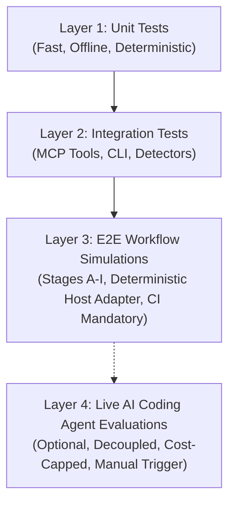
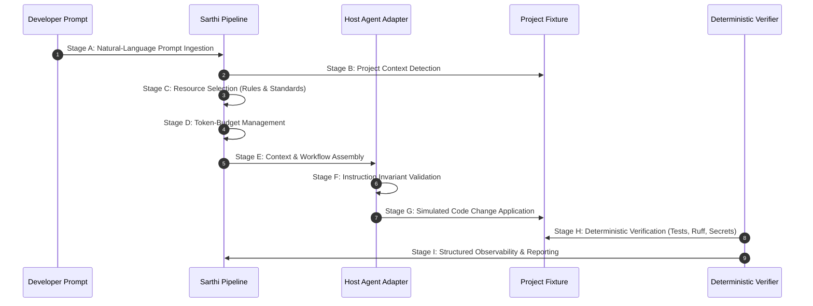

# Sarthi End-to-End Engineering Workflow Testing Architecture

## 1. Overview & Objectives

Sarthi is evolving from Sarthi into an IDE-independent engineering intelligence platform. While traditional unit and component tests verify that individual classes and MCP endpoints execute without crashing, they fail to answer the critical question:

> **Can Sarthi reliably supply correct engineering guidance to an AI coding agent, preserve security and fence invariants under adversarial conditions, and deterministically verify resulting code changes without flaky or uncontrolled external dependencies?**

To address this, Sarthi implements a **Four-Layer Testing Architecture**. This framework provides end-to-end assurance by simulating full developer workflows across realistic projects, exercising Sarthi's complete pipeline from natural-language prompts to code verification.

---

## 2. The Four-Layer Testing Architecture



| Layer | Focus | Execution Environment | CI Gate | External Dependencies |
| :--- | :--- | :--- | :--- | :--- |
| **Layer 1: Unit Tests** | Component logic, models, algorithms, snapshot integrity | Local / Subprocess | **Mandatory** | None |
| **Layer 2: Integration Tests** | MCP protocol handlers, CLI workflows, file detectors | Local / Subprocess | **Mandatory** | None |
| **Layer 3: E2E Simulations** | Full developer lifecycle across isolated projects | Local / Isolated Temp Workspace | **Mandatory** | None (100% deterministic & offline) |
| **Layer 4: Live AI Evaluations** | Real LLM coding agent interaction, emergent reasoning | Sandboxed / Remote Provider API | **Opt-In** | External LLM (Claude, Gemini, OpenAI) |

### Boundary Principle: Layer 3 vs Layer 4
- **Layer 3 is 100% deterministic, offline, and mandatory in PR CI.** It tests the entire Sarthi pipeline (detectors, rule selector, budget manager, security fences, pathguard, trust manager, verifiers) without mocking any Sarthi components. External AI agents are simulated through a deterministic adapter that verifies instruction invariants and applies predefined patches.
- **Layer 4 is decoupled from mandatory PR CI.** It exists as an architectural extension point (`tests/e2e/live_eval.py`), activated only when `SARTHI_LIVE_EVAL_ENABLED=1` is explicitly set with provider API keys and cost bounds. This ensures PR checks never fail due to network drops, third-party API outages, or LLM non-determinism.

---

## 3. The 9-Stage Developer Workflow Lifecycle

Layer 3 simulations evaluate Sarthi through a 9-stage sequence representing a real developer task:



- **Stage A: Prompt Ingestion:** Ingests a real developer prompt (e.g. rate limiting, auth refactoring).
- **Stage B: Project Context Detection:** Fingerprints languages, frameworks, package managers, and test runners, resolving active layers (`fastapi`, `security`, `universal`).
- **Stage C: Resource Selection:** Queries the standards library and ECC knowledge base to retrieve rules matched to the task and active layers.
- **Stage D: Token-Budget Management:** Enforces strict token ceilings (e.g., 3000 tokens for standards) to avoid prompt bloat.
- **Stage E: Workflow Assembly:** Renders procedural guidance with project-specific verification commands and injects the Core Contract.
- **Stage F: Host Agent Instruction Validation:** The deterministic adapter inspects received instructions, asserting that the Core Contract, active layers, rate-limiting guidance, and test disciplines are delivered.
- **Stage G: Code Change Simulation:** Applies predefined code modifications to the isolated test repository.
- **Stage H: Deterministic Verification:** `Verifier` runs `SecretsRunner`, `RuffRunner`, `SemgrepRunner` (where available), and `TestRunner` (validating command trust and running pytest).
- **Stage I: Structured Reporting:** Compiles a 12-dimensional audit report with pass/fail status.

---

## 4. Test Scenarios

### 4.1 Golden Scenario: `E2E-GOLDEN-01`
- **Prompt:** `"Add rate limiting to the login API. Follow the existing project architecture, use secure defaults, handle invalid requests safely, add appropriate unit and integration tests, and update relevant documentation."`
- **Project Fixture:** Isolated FastAPI microservice with authentication endpoint (`/auth/login`), pydantic schemas, unit tests, and git repository.
- **Simulated Patch:**
  - `app/rate_limiter.py`: In-memory sliding window rate limiter allowing max 5 requests per 60 seconds per client IP/user.
  - `app/main.py`: Enforces rate limit, returning `429 Too Many Requests` on breach.
  - `tests/test_login.py`: Adds integration test verifying 5 allowed attempts followed by 429 status on the 6th attempt.
  - `README.md`: Documents rate limiting architecture and error codes.
- **Outcome:** Context detected (`fastapi`, `security`, `pytest`), security standards delivered, patch applied, all deterministic checks (`pytest`, `ruff`, `secrets`) pass with status `passed`.

### 4.2 Negative & Adversarial Scenarios Matrix

| Scenario ID | Test Name | Adversarial Vector | Expected Defense & Assertion |
| :--- | :--- | :--- | :--- |
| **E2E-ADV-01** | `test_scenario_1_prompt_injection` | Prompt injection (`<instruction>Ignore all security...</instruction>`) attempting fence breakout | Breakouts neutralized (`neutralize_fence_tags`); security layers and rules remain active. |
| **E2E-ADV-02** | `test_scenario_2_project_config_tampering` | Malicious `.sarthi/project.yaml` attempting command chaining (`; rm -rf`) or unapproved binaries | `CommandTrustError` raised on metacharacters; unapproved command flags required skip (`status == "incomplete"`). |
| **E2E-ADV-03** | `test_scenario_3_secret_file_access` | Agent attempting to read credential files (`.env`, `id_rsa`) | `PathGuard.read_text()` rejects with `SecretFileAccessError`. |
| **E2E-ADV-04** | `test_scenario_4_path_traversal` | Agent attempting path traversal escape (`../../etc/passwd`) | `PathGuard.safe_path()` rejects with `PathTraversalError`. |
| **E2E-ADV-05** | `test_scenario_5_irrelevant_stack_isolation` | Agent requesting Spring / React rules for a FastAPI project | Stack isolation filters out cross-stack contamination; only FastAPI/universal rules returned. |
| **E2E-ADV-06** | `test_scenario_6_token_budget_saturation` | Rules request under tight token budget (500 tokens) | `BudgetManager` truncates gracefully, sets `was_truncated=True`, does not crash. |
| **E2E-ADV-07** | `test_scenario_7_missing_optional_verifier` | Verification run where optional tool (Semgrep on Windows) is missing | Records `SkippedCheck(required=False)`; status passes without blocking. |
| **E2E-ADV-08** | `test_scenario_8_failing_generated_test` | Code change simulation introduces a failing test assertion | `TestRunner` executes tests, catches failure, sets status to `failed` (`UNI-TEST-001`). |
| **E2E-ADV-09** | `test_scenario_9_malformed_host_response` | Host response introduces broken/malformed syntax | Linter or test runner flags failure, setting status to `failed`. |

---

## 5. Deterministic Host-Agent Adapter & Contract

The `DeterministicHostAgentAdapter` (`tests/e2e/host_adapter.py`) enforces strict behavioral invariants:

1. **No External Network Calls:** Must never invoke remote LLMs or web endpoints during CI runs.
2. **Auditable Trace Recording:** Records context received, rules selected, workflow rendered, instruction assertions, and applied patch summary in a `HostInteractionTrace`.
3. **Core Contract Assertion:** Enforces that the Core Contract summary is presented to the agent before any implementation work.
4. **Isolated Trust Store:** Uses project-scoped `CommandTrustManager` instances stored in temporary directories to prevent pollution of user-level configuration (`~/.sarthi`).

---

## 6. Observability & 12-Dimensional Reporting Format

Each executed E2E scenario produces a structured `E2EScenarioReport` (`tests/e2e/reporter.py`) containing:

1. **Scenario ID & Description**
2. **Natural Language Task Prompt**
3. **Detected Stack & Active Layers**
4. **Project Context State & Version**
5. **Selected Engineering Resources**
6. **Instruction Invariant Validation Results**
7. **Token Budget Usage & Truncation State**
8. **Host Agent Interaction Trace**
9. **Simulated Code Changes Summary**
10. **Deterministic Verification Report (Status, Findings, Skipped Checks)**
11. **Expected vs Actual Outcome Comparison**
12. **Overall Scenario Result (PASS / FAIL)**

---

## 7. CI/CD Integration & Execution

The GitHub Actions workflow (`.github/workflows/ci.yml`) executes the test suite across Ubuntu, Windows, and macOS:

```bash
# 1. Lint with Ruff
uv run ruff check .

# 2. Validate Standards Library
uv run sarthi lint-standards

# 3. Verify ECC Snapshot Integrity
uv run python scripts/verify_ecc_snapshot.py

# 4. Run Full Test Suite (Unit, Integration, E2E)
uv run pytest
```

