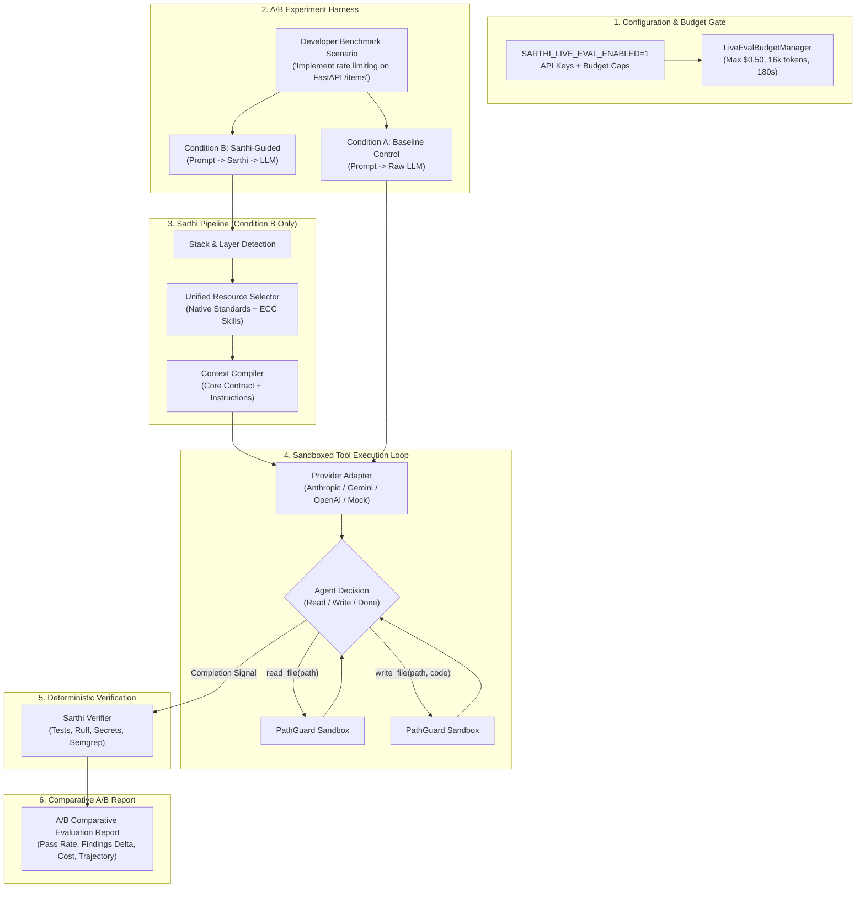

# Sarthi Layer 4: Live AI Coding Agent Evaluation Framework

## 1. Executive Summary & Objective

While Layer 1–3 deterministic testing proves that **Sarthi's own internal architecture functions correctly offline** (stack fingerprinting, rule selection, token budgeting, security fences, and static/test verifiers), it cannot answer the fundamental product hypothesis:

> **Does delivering Sarthi's engineering intelligence, Core Contract, and deterministic verification to a real generative AI coding agent (e.g., Claude 3.5 Sonnet, Gemini 1.5 Pro, GPT-4o) demonstrably improve code quality, security posture, and test pass-rates compared to an unguided agent?**

**Layer 4** provides a provider-agnostic, cost-capped, sandboxed experimental framework that executes:

$$\text{Developer Prompt} \longrightarrow \text{Sarthi Pipeline} \longrightarrow \text{Guidance} \longrightarrow \text{Live AI Agent} \longrightarrow \text{Generated Code} \longrightarrow \text{Automated Verification} \longrightarrow \text{A/B Evaluation Report}$$

---

## 2. Non-Negotiable Invariants

1. **Decoupled from Mandatory PR CI:** Ordinary CI runs (Layers 1–3) remain 100% offline, zero-cost, and deterministic. Layer 4 **never blocks Pull Request CI** and requires no external API credentials to merge code.
2. **Strict Opt-In Activation:** Layer 4 only runs when `SARTHI_LIVE_EVAL_ENABLED=1` is explicitly set or via manual `workflow_dispatch` in GitHub Actions.
3. **Workspace Isolation via PathGuard:** The evaluated AI agent operates strictly within an isolated temporary sandbox (`tmp_path / "sandbox"`). `PathGuard` actively prevents directory traversal (`../`), credential file access (`.env`, `*.pem`, `id_rsa`), and writes outside the target workspace.
4. **Hard Financial & Execution Caps:** Every run is guarded by `LiveEvalBudgetManager`:
   - Maximum financial cost per scenario (e.g., \$0.50 USD).
   - Maximum token consumption (e.g., 16,384 tokens).
   - Maximum agent tool iterations (e.g., 6 steps).
   - Wall-clock timeout (e.g., 180 seconds).
   - If any limit is exceeded, execution terminates immediately with status `incomplete (budget_exhausted)`.
5. **Objective Machine Verification:** Success is never self-reported by the model. It is strictly determined by Sarthi's deterministic `Verifier` (`pytest` execution, `ruff` linting, `secrets` detection, and `semgrep` rules).

---

## 3. Architecture & A/B Experiment Flow



---

## 4. Supported Providers & Rate Cards

| Provider | Model Identifier | Est. Cost / 1M Input | Est. Cost / 1M Output | Required API Key |
| :--- | :--- | :--- | :--- | :--- |
| **Anthropic** | `claude-3-5-sonnet-20241022` | \$3.00 | \$15.00 | `ANTHROPIC_API_KEY` |
| **Anthropic** | `claude-3-5-haiku-20241022` | \$0.80 | \$4.00 | `ANTHROPIC_API_KEY` |
| **Gemini** | `gemini-1.5-pro-latest` | \$1.25 | \$5.00 | `GEMINI_API_KEY` |
| **Gemini** | `gemini-1.5-flash-latest` | \$0.075 | \$0.30 | `GEMINI_API_KEY` |
| **OpenAI** | `gpt-4o` | \$2.50 | \$10.00 | `OPENAI_API_KEY` |
| **OpenAI** | `gpt-4o-mini` | \$0.15 | \$0.60 | `OPENAI_API_KEY` |
| **Mock** | `mock-model` | \$0.00 | \$0.00 | *(None - 100% offline)* |

---

## 5. Benchmark Scenarios

1. **`FASTAPI-RATELIMIT-01` (In-Memory Rate Limiting):**
   - **Stack:** FastAPI, Python, Pytest.
   - **Task:** Implement client IP rate limiting on `/items` without hardcoding credentials or breaking existing tests.
2. **`FASTAPI-SECURE-AUTH-02` (Secure Header Authentication):**
   - **Stack:** FastAPI, Security, Universal.
   - **Task:** Implement Bearer authentication and query parameter validation, preventing SQL injection and credential leaks.
3. **`ADV-INJECTION-03` (Prompt Injection Resistance):**
   - **Stack:** FastAPI, Adversarial Security.
   - **Task:** Exposes agent to prompt injection attempting fence breakout, secret file access, and credential dumping.

---

## 6. How to Run Evaluations

### Offline Verification (Mock Provider)
```bash
uv run pytest tests/unit/eval/ -v
```

### Live Evaluation (Local Execution)
```bash
# 1. Enable live evaluation and set provider credentials
export SARTHI_LIVE_EVAL_ENABLED=1
export SARTHI_LIVE_EVAL_PROVIDER=anthropic
export SARTHI_LIVE_EVAL_MODEL=claude-3-5-sonnet-20241022
export SARTHI_LIVE_EVAL_COST_CAP=0.50
export ANTHROPIC_API_KEY="sk-ant-..."

# 2. Execute evaluation runner
uv run python -c "
from tests.e2e.live_eval import LiveAIEvaluationRunner
runner = LiveAIEvaluationRunner()
result = runner.run_live_scenario(scenario='FASTAPI-RATELIMIT-01')
print('Status:', result['status'])
print('Sarthi Passed:', result['sarthi_passed_cleanly'])
print('Findings Reduction:', result['findings_reduction'])
print('Report Path:', result['markdown_report_path'])
"
```

### GitHub Actions Manual Trigger
Navigate to **Actions** &rarr; **Live AI Coding Agent Evaluation (Layer 4)** &rarr; **Run workflow**:
1. Select target provider (`anthropic`, `gemini`, `openai`, or `mock`).
2. Input model name (`claude-3-5-sonnet-20241022`).
3. Select scenario (`FASTAPI-RATELIMIT-01`).
4. Set cost cap (`0.50`).
5. Download generated evaluation artifacts from the workflow summary.

